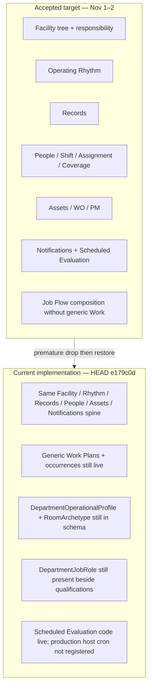

# Phase 0 — Platform Architecture Atlas

**Status:** Phase 0 discovery deliverable. Not an authorization to implement Phases 1–7.  
**Audit date:** November 8, 2026  
**Working branch:** `main`  
**Commit SHA:** `e179c0d52dcc3a71d83c8b0a42a1eb00945de6f8`  
**Companion deliverables:** [Temporal Architecture Audit](./PHASE_0_TEMPORAL_ARCHITECTURE_AUDIT_2026-11-08.md), [Architecture Reconciliation Register](./PHASE_0_ARCHITECTURE_RECONCILIATION_REGISTER_2026-11-08.md)

---

## Executive summary

Vssyl already has a coherent platform spine: one physical Facility tree, one Department Product registry, one Operating Rhythm engine, one Records Catalog chain, one shared Asset / maintenance domain, separate Shift and Assignment facts, one Job Flow composition, one Notifications & Attention engine, and one Scheduled Evaluation clock.

The architecture is **partially fragmented**, not blank, and not freely duplicated. The dominant risk is not missing engines. It is **accepted forward architecture that was prematurely deleted, then restored into a live schema that still runs the older paths**.

| Layer of truth | What it says today |
|---|---|
| Binding amendments (Nov 1–2, 2026) | Generic Work and Location Function / Department profile are retired before release. Department Builder is Overview / Facility / Operating Rhythm / People & Coverage / Records, plus Product extensions. |
| Live schema at HEAD | `DepartmentWorkPlan*`, `DepartmentOperationalProfile`, `DepartmentRoomArchetype*`, `DepartmentJobRole*`, and related enums/columns are present again after `20261106214500_restore_schema_after_premature_retirement`. |
| Live application code | Department Builder still exposes a Work tab. Job Flow still loads Work Plans. ~144 source files still reference profile / archetype / operational-type paths. Product registry still advertises Location Functions and Work. |
| Certification tests such as Phase 6 retirement | Assert those models and modules are gone — evidence that retirement intended to complete, then production restore reversed the schema side. |

**Verdict for this atlas:** preserve the current owners; do not invent parallel engines; reconcile ownership debt before shared-timeline or Role Job Flow work.

Diagrams below distinguish **current implementation** from **accepted target**. Target is not certified until Phase 1+ is authorized.

---

## Authority hierarchy used by this audit

| Priority | Document | Role |
|---|---|---|
| 1 | [01 Product Constitution](../product/01_PRODUCT_CONSTITUTION.md) current foundation (Oct 26) + Oct 29 Notifications amendment | Platform map |
| 1a | [01A Department Builder Foundation Amendment](../product/01A_DEPARTMENT_BUILDER_FOUNDATION_AMENDMENT_2026-11-01.md) | Supersedes generic Work and Location Function language in older Constitution prose |
| 2 | [16 Department Builder Architecture](../product/16_DEPARTMENT_BUILDER_ARCHITECTURE.md) | Builder contract |
| 3 | [15 Platform Primitives Registry](../product/15_PLATFORM_PRIMITIVES_AND_ENGINES_REGISTRY.md) + [15A](../product/15A_DEPARTMENT_BUILDER_REGISTRY_AMENDMENT_2026-11-01.md) | Reuse map |
| 4 | [03 Domain Model](../product/03_PRODUCT_DOMAIN_MODEL.md), [08 Language Guide](../product/08_PRODUCT_LANGUAGE_GUIDE.md), [13 Department Product](../product/13_DEPARTMENT_PRODUCT.md), [16 Notifications](../product/16_NOTIFICATIONS_AND_ATTENTION.md) | Ownership, words, Product contract, attention |
| Program logs | Dashboard, CDA, Legacy Retirement, Onboarding, Department Administration visual audits | How decisions were reached; do not override 1–4 |

**Document conflict rule applied here:** when Constitution long-form still names Location Function or generic Work as shared engines, Nov 1–2 amendments win. When Nov 4 elimination / retirement docs claim tables are gone, live schema + HEAD commit `e179c0d` win for current implementation status.

---

## Full platform layer map

```text
GOVERNANCE
  Organization, Facility access, RoleKey periods, licensing, Harbor/Console

PLATFORM ENGINES / PRIMITIVES
  Facility tree + responsibility
  Department Product registry + install/entitlement/operator
  People / Teams / operational eligibility / Shift / Assignment / Coverage
  Operating Rhythm (Cycle → Phase → Key Point + actuals)
  Records Catalog chain
  Shared Assets + Requests / Issues / Work Orders / PM
  Menus (Food & Nutrition capability)
  Knowledge / Procedures
  Notifications & Attention
  Scheduled Evaluation
  Facility-local Operational Time
  Offline sync receipts

DEPARTMENT PRODUCT
  Food and Nutrition (AVAILABLE, install key DIETARY)
  Facility Plant Operations (AVAILABLE, install key PLANT)
  Environmental Services (DEVELOPMENT)

FACILITY CONFIGURATION
  Bound places, published rhythms, people, installed Products, Catalog installs

RUN COMPOSITIONS (own nothing)
  Dashboard, Job Flow / Employee Runtime Flow, Runtime Location State,
  Location / unit workspaces, Notification Center shell

HISTORY / AUDIT
  Service-date reconstruction from historically effective owners
```

### Current vs target layer emphasis



---

## Builder ownership map

| Builder / surface | Canonical URL(s) | Owns (writes) | Displays / composes only | Must edit elsewhere |
|---|---|---|---|---|
| **Facility Builder** | `/admin/facility/builder` | Physical Unit / UnitSpace tree, Facility Room Types, Department responsibility | — | Department meaning, cycles, people |
| **Department Builder** | `/build/departments/[id]` (files under `admin/departments/[id]`; Next rewrite from `/build/…`) | Operating Rhythm drafts/publish; Coverage templates; Records attachment placement via Records tab; Product extensions; **Locations still writes Location Function adopt/bind/publish** (ARR-026); Work tab links to `/staffing/work-plans` authoring | Overview summaries; People organization labels; Menus tab mostly links to `/menus` | Physical places (Facility Builder); Employee identity (Employee Builder); Work plan CRUD on staffing/partner surfaces |
| **Employee Builder** | `/employees`, related HR / import / qualifications / job-roles routes | Employee identity, membership, Teams membership, HR fields, operational qualifications (forward), residual job-role UI | Schedule labels | Coverage needs (Dept Builder); Assignments (Run) |
| **Records / Logs Builder** | `/build/logs`, Catalog attach routes | Facility Catalog installs and LogAttachments when Canonical Logs on | Harbor Catalog definitions | Submitted evidence (Run); Harbor publishing (Console) |
| **Asset Builder** | `/assets/builder` | Asset identity, location, responsible Department, criticality, retirement | — | Condition / Issues / Repairs (RUN Maintenance) |
| **Menu Builder** | `/menus`, `/menus/[menuId]`; Dept Builder Menus tab | Menu identity/content; applicability rows | Cycle timing owned by Operating Rhythm | Cycle definition |
| **Procedures & Resources** | `/admin/knowledge`; Catalog-linked procedures via Logs | Facility KnowledgeArticle versions; Catalog links | Harbor-published procedures appear via Logs install | Operational evidence |
| **Preventive Maintenance** | `/build/departments/[id]/preventive-maintenance*` | PM plans/versions/requirements | — | Generated Work Orders (`Repair`) |
| **Platform Console / Harbor** | `/console/*` | Catalog publish, facility/partner provisioning, support | Customer Run | Facility day-of truth |
| **Partner workspace** | `/partner/*` | Partner-scoped Department configuration and Run within CDA rules | Facility Builder / Administration denied | Facility-wide governance |

### Department Builder section contract

| Accepted contract (16 / 01A) | Live nav (`admin-nav.ts`) | Status |
|---|---|---|
| Overview | `overview` | Implemented composition |
| Facility | `locations` (still labeled “Locations” / Location Functions in copy) | Partial — composition improved; profile/archetype debt restored |
| Operating Rhythm | `operating-rhythm` | Implemented |
| People & Coverage | `people` | Implemented composition + Coverage writes |
| Records | `records` | Implemented when record engine paths enabled |
| Menus extension (F&N) | `menus` | Implemented |
| PM extension (Plant) | `maintenance` → PM builder | Implemented |
| Work (retired) | `work` still a primary tab | **Conflict — live deletion debt** |

Evidence: `src/lib/department-administration/admin-nav.ts`, `src/app/(protected)/admin/departments/[departmentId]/page.tsx`, `DepartmentWorkPanel` still mounted.

### Department Product registry (code)

| productKey | Install key | Status | Starters still naming Work |
|---|---|---|---|
| `HEALTHCARE_FOOD_NUTRITION` | `DIETARY` | AVAILABLE | `workPresets: true`; customerCapabilities still list Location Functions and Work |
| `EVS` | `EVS` | DEVELOPMENT | `workPresets: true` |
| `PLANT` | `PLANT` | AVAILABLE (`1.0`, 2026-10-07) | `workPresets: true`; copy still mentions recurring operational Work |

Source: `src/lib/department-products/registry.ts`.

---

## Engine and primitive registry (implementation status)

Classification key: **Primitive** / **Domain Owner** / **Engine** / **Resolver** / **Projection** / **Composition** / **Catalog** / **Governance**.

| Name | Class | Source of truth | Authoritative services | Build entry | Run consumers | Status |
|---|---|---|---|---|---|---|
| Physical Facility tree | Domain Owner | `Facility`, `Unit`, `UnitSpace`, `FacilityRoomType` | Facility Builder actions under `admin/facility/builder` | Facility Builder | Everywhere scoped by place | **Implemented** |
| Department responsibility | Domain Owner | `UnitDepartmentResponsibility`, `UnitSpaceResponsibility` | Facility Builder | Facility Builder | Cycles, Records, Coverage, RLS | **Implemented** |
| Department Product registry | Catalog + Governance | Code registry | `src/lib/department-products/*` | Marketplace / setup / admin departments | Admission, starters | **Implemented** |
| Install / entitlement / operator | Governance + Domain Owner | `Department`, `FacilityDepartmentEntitlement`, `DepartmentOperatorRelationship`, partner tables | CDA / operators modules | Setup, Console, Dept manage | Authority writes | **Implemented** (CDA flag default false in code) |
| People / Teams | Domain Owner | `Employee`, `EmployeeDepartment`, `DepartmentTeam`, memberships | Employee Builder + team actions | `/employees`, Dept People | Schedule labels, Assignment pickers | **Implemented** |
| Platform RoleKey access | Governance | `UserFacilityAccess`, `UserFacilityRolePeriod` | Access / policy | Admin permissions | All routes | **Implemented** |
| Operational eligibility | Domain Owner | `EmployeeOperationalRoleQualification` (+ exception rows) | `src/lib/employee-operational-qualifications/*` | Employee Builder | Assignment validation | **Partial** — models restored/added; thin live surface |
| Department Job Role | Legacy / deletion debt | `DepartmentJobRole`, `EmployeeDepartmentJobRole` | `src/lib/department-job-roles/*` | `/employees/job-roles` | Schedule labels | **Legacy present after restore** — Phase 7B said removed |
| Shift | Domain Owner | `ScheduleEntry`, `WorkShift`; call-off columns | `src/lib/scheduling/*` | Staffing / People | Coverage, Job Flow presence | **Implemented** |
| Daily Assignment | Domain Owner | `OperationalAssignment*`, plans, events | `src/lib/scheduling/operational-assignments/*` | Assignments Run + templates | Coverage, Job Flow, notifications | **Implemented** |
| Coverage need + episodes | Domain Owner + history | Templates/items; `CoverageEpisode*` | `coverage-expectations`, `coverage-episodes` | Dept People & Coverage | Dashboard, notifications | **Implemented** |
| Operating Rhythm | Engine | `DepartmentOperationalCycle*` + expectations + actuals | `src/lib/operational-cycles/*` | Dept Operating Rhythm | Job Flow, RLS, Audit, KP overdue | **Implemented** |
| Generic Work | Retired forward / live debt | `DepartmentWorkPlan*`, occurrences, events | `src/lib/department-work/*` | Dept Work tab, `/staffing/work-plans` | Job Flow, RLS, review | **Live but architecturally retired** |
| Records Catalog chain | Engine | `CatalogLogDefinition` → `FacilityCatalogInstall` → `LogAttachment` → `OperationalEvidenceRecord` | `src/lib/canonical-logs/*`, `logs-architecture` | `/build/logs`, Dept Records | Run logs, Job Flow, Audit | **Implemented** behind `CANONICAL_LOGS_ENABLED` (code default false) |
| Shared Assets | Domain Owner | `Asset`, status history, presence notes | Asset ops + Asset Builder | `/assets/builder` | Maintenance, notifications | **Implemented** |
| Requests / Issues / Work Orders | Domain Owner | `OperationalRequest`, `AssetIssue`, `Repair` | `src/lib/asset-operations/*`, request modules | Plant / Maintenance RUN | Job Flow, Dashboard, notifications | **Implemented** |
| Preventive Maintenance | Domain Owner | `PreventiveMaintenancePlan*` + occurrences | Plant PM libs + daily cron | Dept PM builder | Generates `Repair` | **Implemented** (daily host cron) |
| Menus | Domain Owner (F&N) | `Menu*`, applicability | `menu-db`, `menu-applicability-db`, `menu-runtime-db` | `/menus`, Dept Menus | Run menu resolution | **Implemented** |
| Knowledge | Domain Owner | `KnowledgeArticle*` | Knowledge admin | `/admin/knowledge` | Record context links | **Implemented** |
| Runtime Location State | Composition / Resolver | No store — composes owners | `src/lib/runtime-location-state/*` | — | Locations, Dashboard, Job Flow | **Implemented** |
| Job Flow / Employee Runtime Flow | Composition | No store | `employee-runtime-flow`, `dietary-job-flow` | — | Frontline my-work | **Implemented** but still reads Work Plans |
| Dashboard | Composition | Layout prefs only | `src/lib/dashboard/*` | Layout settings | Supervisor home | **Implemented** (program continues) |
| Notifications & Attention | Engine | Outbox, Notification, Recipient, Delivery, Push* | `src/lib/notifications/*` | Dept policy presets (partial) | Bell / Center | **Partial** — foundation + many live publishers; production clock/push off |
| Scheduled Evaluation | Engine (clock) | `ScheduledEvaluationLease` | `src/lib/scheduled-evaluation/*` | — | Coverage/KP/WO/escalation/push evaluators | **Implemented in code; production host cron not registered** |
| Operational Time | Primitive | `Facility` timezone + utilities | `src/lib/operational-time/*` | Facility settings | All time-aware domains | **Implemented** |
| Offline sync | Domain Owner | Bundle issuance, receipts, conflicts | `src/lib/offline/*` | — | Space offline | **Implemented** (certified in ONB materials; not re-certified this audit) |
| Location Function / profile / archetype | Retired | Profile + archetype + Experience tables | `department-administration`, `location-functions.ts`, projection leftovers | Historical Locations UI debt | Many matchers/tests | **Schema restored; forward docs say retired** |
| Experience / Operational Area | Legacy projection | Experience tables | `src/lib/experiences`, projection | Closed Facility authoring path | Residual decoration | **Legacy debt** |

---

## Builder → engine dependency matrix

| Builder | Facility | Rhythm | Records | People/Shift/Assign/Coverage | Assets/WO/PM | Menus | Knowledge | Notifications | Work (debt) |
|---|---|---|---|---|---|---|---|---|---|
| Facility Builder | **owns** | — | — | — | places only | — | — | — | — |
| Department Builder | reads | **owns** | attaches | Coverage owns; People reads | PM extension owns | Menus extension | links | policy config | **still owns Work tab** |
| Employee Builder | — | — | — | People / eligibility owns | — | — | — | prefs elsewhere | labels only |
| Records Builder | targets places | timing windows | **owns chain** | — | asset targets | — | links | — | — |
| Asset Builder | places | — | — | — | **owns identity** | — | — | — | — |
| Menu Builder | places | cycle keys | — | — | — | **owns** | — | — | — |
| Knowledge | — | — | Catalog links | — | asset links | — | **owns** | — | — |
| Console | provision | — | Catalog publish | — | — | — | publish | support notices ≠ engine | — |

---

## Engine → engine dependency matrix

| From \\ To | Facility | Rhythm | Records | Shift | Assignment | Coverage | Assets/WO | Menus | Notifications | SchedEval | Job Flow |
|---|---|---|---|---|---|---|---|---|---|---|---|
| Facility | — | places | places | — | places | places | places | places | scope | facility scan | places |
| Rhythm | resp. places | — | optional timing | — | window context | periods | — | applicability keys | KP overdue | KP evaluator | current window |
| Records | targets | windows | — | — | — | — | asset targets | — | evidence.failed | (future not registered) | due items |
| Shift | — | — | — | — | presence filter | call-off | — | — | — | — | on-duty |
| Assignment | places | — | — | independent | — | fill | — | — | assignment.changed | — | my places |
| Coverage | places | periods | — | call-off | actuals | — | — | — | coverage transitions | time-boundaries | attention |
| Assets/WO/PM | places | — | requirements | — | assignee | — | — | — | WO/asset events | WO overdue | assigned WO/PM |
| Menus | places | cycle keys | — | — | — | — | — | — | — | — | optional display |
| Notifications | — | — | reads facts | — | reads | reads | reads | — | — | escalation/delivery | Center |
| SchedEval | scans | asks | — | — | — | asks | asks | — | asks | — | — |
| Job Flow | — | reads | reads | reads | reads | reads | reads | — | — | — | — |

Generic Work is intentionally omitted from the forward matrix; it still feeds Job Flow and Runtime Location State in current code.

---

## Run surface consumption map

| Run surface | Primary owners read | Persists? |
|---|---|---|
| `/dashboard` | Coverage, Records due, Assets/Issues/WO, Assignments, Attention composition | Layout only |
| Job Flow / employee runtime | Assignment, Cycles, Work Plans (debt), Records due, assigned Repair/PM, RLS | No |
| Unit / space workspaces | RLS composition | No |
| `/logs` / Run Records | Catalog requirements + evidence | Evidence writes |
| `/repairs`, `/assets` | Repair / Asset | Domain writes |
| `/notifications` | Notification threads | Read/ack/snooze only |
| `/staffing/*` | Shift / Assignment / Coverage | Domain writes |
| `/reports` Audit | Historically effective config + facts | No central ledger |
| Partner Run mirrors | Same owners under partner authority | Same rule |

---

## Admin and Department Product boundaries

- **Facility Administrator:** governance, Facility Builder, operator attachment; views self-operated Departments unless head.
- **Department head / members:** configure and run their Department within role and CDA write-manifest classification (`src/lib/department-authority/write-manifest.ts`).
- **Vendor-run operator:** controls that Department and owns period data; Facility Admin sees summary + compliance Records.
- **Harbor / Console:** not a customer Run home; publishes Catalog and provisions accounts.
- **Department Products contribute Dashboard capabilities, not Dashboard UI** (`docs/dashboard/DEPARTMENT_DASHBOARD_CONTRACT.md`).
- **Do not add capability environment switches** (LEG-D20). Remaining flags such as `CANONICAL_LOGS_ENABLED` and `CONTRACTED_DEPARTMENT_AUTHORITY_ENABLED` are rollout/governance switches, not per-capability Product toggles.

---

## Progressive configuration / graceful degradation (observed)

| Optional domain | True prerequisite | Observed missing behavior | Must not invent |
|---|---|---|---|
| Operating Rhythm | Installed Department | `resolve-operational-cycle` → `NOT_CONFIGURED` / no window | Meal-time guess |
| Shifts | Employee + Department | Person not scheduled; Coverage/Job Flow degrade | Fake presence |
| Assignments | Optional | Job Flow falls back to signed-in place Work/Records; empty plan must not hide Work (foundation) | Mandatory Assignment |
| Coverage requirements | Templates | No deficiency episodes from absent need | Fake understaffing |
| Records attachments | Catalog install + attachment | No due Records | Overdue from missing config |
| Job Flow | Installed Department (`isDepartmentJobFlowEnabled` ≈ any key) | Null only when gated off / unauthorized | Persistent MyWork store |
| PM plans | Plant Product | No generated occurrences | Rhythm overdue |
| Menus | F&N Product + applicability | No applicable menu | Cycle timing substitute |
| Notifications / push | Domain events + clock/flags | In-app may exist; production push off; clock inactive | Parallel Department alerters |

Principle vs reality: the principle “absent optional configuration is not an operational exception” is accepted. Live code mostly follows it for Cycles (`NOT_CONFIGURED`). Residual risk is Work/Location-Function matchers treating empty bindings as no rooms (correct) while UI still presents Work/Location Function as configuration gaps (drift).

---

## What is architecturally strong (do not replace)

1. Layer model: Platform → Department Product → Marketplace item → Facility config → Run → History → Governance.
2. One physical tree + responsibility rows.
3. Operating Rhythm as the only “what is happening now.”
4. Shift ≠ Assignment ≠ Coverage need.
5. One Records Catalog chain.
6. Plant Requests / Issues / Work Orders / PM as domain capabilities, not generic Work.
7. Notifications as attention delivery only; domains own truth.
8. One Scheduled Evaluation registry for time-passing questions.
9. Screens compose; they do not become owners.
10. Forward-only Prisma migrations; no silent applied-migration edits.

---

## Recommended implementation sequence (Phase 0 assessment)

Proposed program order confirmed with adjustments:

| Phase | Recommendation | Rationale |
|---|---|---|
| **0 Audit** | **This deliverable — stop here** | Certified understanding before contracts rewrite |
| **1 Architecture Contracts & Documentation** | **Next, after PO approval** | Reconcile Constitution / Domain Model / Registry / Language Guide / Product registry copy with Nov 1–2 amendments *and* restore reality |
| **2 Ownership & Legacy Reconciliation** | After Phase 1 | Trace-and-retire Work, profile/archetype, Job Role leftovers; no premature drops |
| **3 Shared Temporal Foundation** | After ownership clarity | Extend `operational-time` + Scheduled Evaluation; do not add a second global scheduler |
| **4 Unified Operational Timeline** | After Phase 3 | Projection over owners; not a new fact store |
| **5 Optional Role Job Flows** | After timeline primitives + Work removal from Job Flow | Compose role-scoped views without MyWork tables |
| **6 Runtime & Notification Integration** | Parallel-safe pieces exist; production clock needs host decision | Wire remaining triggers; enable clock only with sub-hour cron + push safety |
| **7 Certification & Extensibility** | Last | Evidence gates, calendar extensibility rules |

**Blockers requiring product-owner approval before Phase 1 closes:** listed in the Reconciliation Register and final report.

---

## Source evidence index

| Area | Paths |
|---|---|
| Schema | `prisma/schema.prisma` (~182 models) |
| Restore migration | `prisma/migrations/20261106214500_restore_schema_after_premature_retirement/` |
| Premature retirement | `prisma/migrations/20261103140000_retire_generic_work_and_profiles/` |
| Department Builder nav | `src/lib/department-administration/admin-nav.ts` |
| Job Flow loader | `src/lib/employee-runtime-flow/load-flow.ts` |
| Work engine debt | `src/lib/department-work/` |
| Cycles | `src/lib/operational-cycles/` |
| Scheduling | `src/lib/scheduling/` |
| Records | `src/lib/canonical-logs/`, `src/lib/logs-architecture/` |
| Notifications | `src/lib/notifications/` |
| Scheduled Evaluation | `src/lib/scheduled-evaluation/`, `src/app/api/internal/scheduled-evaluation/route.ts` |
| Host crons | `vercel.json` (support automation + PM only) |
| Operational time | `src/lib/operational-time/` |
| Product registry | `src/lib/department-products/registry.ts` |
| Binding decisions | `docs/product/01A_*`, `15A_*`, `16_DEPARTMENT_BUILDER_ARCHITECTURE.md` |

---

## Verification performed / limits

**Performed**
- Read Constitution, amendments, registry, Department Builder architecture, Notifications, Domain Model ownership, Work retirement, Location Function elimination audit, employee eligibility docs, scheduling contract, legacy retirement tracker.
- Inspected Prisma models, recent migrations, `vercel.json`, Scheduled Evaluation registry/cron, Department Builder nav/page, Job Flow loader, Product registry, route registry samples.
- Quantified remaining references (Work ~60 files, Location Function/profile ~144 files, Job Role ~19 files).

**Not performed in Phase 0**
- Full hermetic/db test suite execution.
- Production Neon row counts or live cron invocation logs.
- Browser certification of Notification Center / push.
- Exhaustive reader/writer matrix for every Prisma model.

**Limitation:** any Nov 4 “tables are gone” documentation is superseded as *implementation status* by HEAD restore `e179c0d`, while remaining binding as *architecture intent*.
