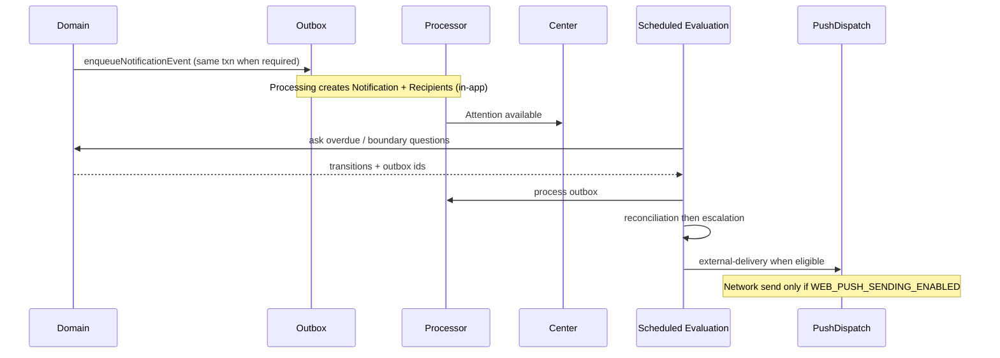

# Phase 0 — Temporal Architecture Audit

**Status:** Phase 0 discovery deliverable. Documentation only.  
**Audit date:** November 8, 2026  
**Commit SHA:** `e179c0d52dcc3a71d83c8b0a42a1eb00945de6f8`  
**Companion:** [Platform Architecture Atlas](./PHASE_0_PLATFORM_ARCHITECTURE_ATLAS_2026-11-08.md), [Reconciliation Register](./PHASE_0_ARCHITECTURE_RECONCILIATION_REGISTER_2026-11-08.md)

---

## Executive finding

Shared facility-local time primitives and a single Scheduled Evaluation clock **already exist**. Domain-specific recurrence (Cycles, PM cadence, Records windows, Coverage periods) is legitimate ownership, not duplication.

The critical gap is **execution**, not invention:

- Scheduled Evaluation is implemented and tested.
- Intended cadence is **5 minutes**.
- `vercel.json` does **not** register `/api/internal/scheduled-evaluation`.
- Only daily crons run today: support automation and Plant preventive maintenance.
- Notifications docs and hermetic tests certify that the production clock is inactive until the host accepts a sub-hour cron (Hobby is daily-only).

**Do not design a second global scheduler.** Extend Scheduled Evaluation and Operational Time.

---

## Existing time primitives and utilities

### `src/lib/operational-time`

| Module | Responsibility |
|---|---|
| `resolve-facility-timezone.ts` | IANA timezone resolution + default |
| `load-facility-timezone.ts` | Load from Facility row |
| `zoned-parts.ts` | Facility-local calendar parts from UTC instant |
| `service-date.ts` | Facility service date / civil date keys |
| `build-operational-time-context.ts` | Context builder; HH:MM → UTC with DST-aware offset probe |
| `iana-timezones.ts` / `facility-timezone-options.ts` | Curated timezone catalogs |
| `*.test.ts` | Hermetic coverage including DST edge notes |

**Exports (index):** timezone resolve/load, operational context, scheduled-start parsers, service-date helpers, local parts.

**DST / overnight notes in code:** `parseFacilityLocalScheduledStartOnDate` documents DST straddle behavior — nonexistent times keep approximation; ambiguous times keep first match; round-trip correction applied when possible. Overnight windows are owned by domain window resolvers (Cycles, Assignments), not by this primitive.

### Domain window helpers (appropriate specialization)

| Domain | Path | What it owns |
|---|---|---|
| Operating Rhythm | `operational-cycles/cycle-windows.ts`, `cycle-timeline.ts`, `key-time-day-expectation.ts`, `day-expectation.ts` | Cycle/Phase instants, Key Point expected minutes, same-day adjustments |
| Shifts | `scheduling/shift-clock-time.ts`, `canonical-shift-*`, `call-off-window.ts` | HH:MM shift bounds, call-off covering an instant |
| Assignments | `scheduling/operational-assignments/*` | Service-date placement windows; overnight coverage across midnight |
| Coverage | `coverage-expectations/*`, `coverage-episodes/time-evaluation.ts` | Need windows vs actuals; time-boundary transitions |
| Records | `logs-architecture/due-state.ts`, attachment daily windows / cycle selections | Due / open / closed windows from attachment config |
| Work Orders | `Repair.dueAt`, `work-order-time-evaluation.ts` | Operational deadline instant (not `targetDate`) |
| PM | Plant PM generator + daily cron | Civil-day occurrence schedule → Work Order deadline rules |
| Notifications | `escalation.ts`, snooze/quiet preference timing | Escalation deadline frozen at create; delivery eligibility |
| Job Flow | `employee-runtime-flow/load-flow.ts` + cycle window resolve | Current window for my-work composition |
| Audit | `audit/*`, `operational-review/*` | Historically effective configuration for a service date |

---

## Scheduling and evaluation infrastructure

### Scheduled Evaluation (canonical clock)

```text
Host cron (NOT registered in production vercel.json today)
  → POST /api/internal/scheduled-evaluation
  → Bearer CRON_SECRET
  → runScheduledEvaluations + processScheduledEvaluationOutbox
  → per-evaluator leases on ScheduledEvaluationLease
```

| Constant | Value | Meaning |
|---|---|---|
| `SCHEDULED_EVALUATION_CADENCE_MS` | 5 minutes | Target tick |
| `SCHEDULED_EVALUATION_LEASE_MS` | 6 minutes | Lease outlives one pass |
| `SCHEDULED_EVALUATION_EXECUTION_BUDGET_MS` | 4 minutes | Pass self-stops |
| `SCHEDULED_EVALUATION_OVERDUE_MS` | 10 minutes | Health overdue band |
| Facility batch | 25 | Continuation paging |
| Coverage episode batch | 100 | Coverage-specific page |

Registered evaluators (`registry.ts`):

1. `coverage.time-boundaries`
2. `key-points.overdue`
3. `work-orders.overdue`
4. `notifications.responsibility-reconciliation`
5. `notifications.escalation`
6. `notifications.external-delivery`

Future key present but unregistered: `operational-day.handoff-overdue`.  
Explicit non-candidate: Records corrective-action overdue (corrective text has no open due owner).

### Independent host schedules (legitimate domain jobs)

| Path | Schedule | Role |
|---|---|---|
| `/api/internal/plant/preventive-maintenance` | `0 6 * * *` daily | PM occurrence generation — domain recurrence, not attention clock |
| `/api/internal/support/automation` | `0 16 * * *` daily | Harbor support automation — not operational time |
| `/api/internal/scheduled-evaluation` | **none in vercel.json** | Shared operational clock — **blocked for production host** |

Hermetic evidence: `scheduled-evaluation.hermetic.test.ts` and `external-delivery.hermetic.test.tsx` assert `vercel.json` does not include `scheduled-evaluation`.

### Write-path vs clock-path time effects

| Concern | On write | On Scheduled Evaluation |
|---|---|---|
| Assignment changed attention | Live publish | — |
| Coverage state from assignment/plan | Live transitions | Time-boundary raise/expire |
| Key Point overdue | — | Evaluator (production inactive) |
| Work Order assigned | Live Update | — |
| Work Order overdue | — | Evaluator (production inactive) |
| Asset out of service | Live | — |
| Evidence failed / issue created | Live | — |
| Escalation / responsibility reconcile / push | — | Evaluators (clock inactive; push flag off) |

---

## Domain-specific timing rules (current)

### Operating Rhythm

- Published Cycle + Phase is the only “happening now.”
- No published / none applicable → `NOT_CONFIGURED` (not overdue).
- Key Point overdue only when `occurrenceTracking = REQUIRED`.
- Expected minute = same-day adjustment else configured facility-local minute.
- Actual = `OperationalCycleKeyPointActual`.
- Cycles may overlap and cross midnight.

### Workforce shifts and assignments

- Shift: who / Department / when (`ScheduleEntry`).
- Assignment: where / role today (`OperationalAssignment`).
- Neither creates the other.
- Call-off marks the shift and stops overlapping Assignment from counting toward Coverage without deleting the Assignment row.
- Overnight Assignments can cover the next civil morning instant.

### Coverage windows

- Need from template item: role + place + period cycle keys + count + effective interval.
- Episodes record deficiency history.
- Time evaluator advances priority / expiry when windows pass.

### Records schedules

- Attachment daily windows and/or cycle selections.
- Due state derived; missing attachment ≠ overdue.
- `CANONICAL_LOGS_ENABLED` gates forward engine (code default false).

### Maintenance / PM

- PM owns civil-day recurrence via plan versions.
- Daily cron generates occurrences / Work Orders.
- Generated WO deadline uses facility-local next-day start rules (domain model ownership row).
- Not an Operational Cycle.

### Work Order deadlines

- `dueAt` = operational deadline.
- Null deadline is never overdue.
- `targetDate` is planning only.
- `responseRequirement` (STANDARD/IMMEDIATE) is separate from deadline and from notification priority.

### Notification scheduling and escalation

- Escalation due = `createdAt + 15 minutes` (frozen).
- Reconciliation before escalation.
- Snooze suppresses external interruption only.
- Quiet Hours suppress eligible informational external delivery only.
- Push sending requires `WEB_PUSH_SENDING_ENABLED === "true"` exactly; production stays off while clock inactive.
- PushDispatch is a delivery occurrence, not a Notification thread.

### Job Flow current window

- Loads facility timezone + service date via Operational Time.
- Loads published cycles for date; resolves window instants.
- Still also resolves Work Plan requirements (retirement debt).

### Historical Audit / Reports

- Reconstructs expected vs actual from configuration effective on the service date.
- Must not use “ACTIVE now” profile semantics for past dates.
- Location Function historical selectors are deletion debt relative to Nov 2 decision.

---

## Notification execution path (temporal view)



Write-driven events can appear in-app without the clock. Time-shaped overdue/escalation/push cannot be production-certified until the host cron exists.

---

## Fragmented or duplicated timing behavior

| Observation | Classification | Action |
|---|---|---|
| Operational Time primitive + many domain window helpers | Legitimate specialization | Keep; prefer Operational Time for civil date / TZ |
| Scheduled Evaluation vs PM daily cron | Legitimate (attention clock vs domain generator) | Keep both |
| Support automation cron | Unrelated governance/support | Keep separate |
| Meal-time guess (`meal-daypart`) | Retired by foundation | Do not restore |
| Generic Work schedule kinds (cycle/fixed/once) | Retired architecture still in schema/code | Remove with Work reconciliation |
| Multiple “due” calculators (Records, WO, KP, Coverage) | Domain-owned answers | Keep separate; timeline may *project* them |
| Job Flow recomposing cycle windows | Composition OK | Must not invent alternate Cycle truth |
| Docs claiming production clock inactive + code matching | Aligned | Host decision needed to activate |
| Inspection `facilityLocalDateTimeToUtc` spring-forward snaps +1h (`work/inspections/facility-local-due-at.ts`) vs Operational Time keeping first approximation | Confirmed policy fork (ARR-027) | Unify under Operational Time in Phase 3 |
| `employee-units.ts` `setHours(0,0,0,0)` process-local “today” | Facility-TZ bypass (ARR-028) | Use service-date helpers |
| Assignment `responsibility-window.ts` noon-UTC probe then parse | Mild duplicate path | Prefer `parseFacilityLocalScheduledStartOnDate` |
| Coverage missing cycle clock → 10080-minute sentinel (stay Needs Attention) | Legitimate degradation | Keep; document — not an invented imminent window |
| Client `setInterval` offline sync / UI refresh timers | Not platform clocks | Ignore for scheduler design |

**Not duplication:** PM recurrence logic living beside Scheduled Evaluation.

---

## Constraints for a future unified operational timeline

A unified timeline must be a **projection / composition**, not a new source-of-truth engine.

| Constraint | Rule |
|---|---|
| Ownership | Each event cites its domain owner id + type |
| No merge store | Do not create `TimelineEvent` as operational truth |
| Optional domains | Missing Rhythm/Shifts/Assignments/Records/PM contribute zero events, not failures |
| Service date | Always facility-local via Operational Time |
| Versioning | Historical views use effective-dated owner config |
| Clock | Time-passing detection stays on Scheduled Evaluation |
| Contribution API | Domains register contributors or emit typed facts; timeline reads |
| Calendar extensibility | External calendar sync is a consumer of the projection, not a second scheduler |
| Overnight / DST | Contributors must use shared civil-date and local-instant helpers |
| Permissions | Timeline rows inherit domain + facility scoping; UI never broadens |

### Smallest reusable architecture

```text
Operational Time (civil date, TZ, local instant)
        ↑
Domain owners (Cycle, Shift, Assignment, Coverage, Records, WO/PM, Notifications)
        ↑
Scheduled Evaluation (asks “did time change a fact?”)
        ↑
Unified Timeline projection (ordered read model for a principal + service date)
        ↑
Optional Role Job Flow / Calendar adapters (compose further)
```

---

## Constraints for role-based Job Flows

| Constraint | Rule |
|---|---|
| Composition only | No `MyWorkItem` table |
| No generic Work dependency | After reconciliation, Job Flow reads Rhythm, Records, Assignments, domain WO/PM only |
| Role meaning | Operational `roleKey` from registry + eligibility — not DepartmentJobRole capabilities |
| Optional Assignment | Empty Assignment does not hide place-scoped Records/domain work |
| Optional Rhythm | `NOT_CONFIGURED` means no timing window, not invented tasks |
| Notifications | Attention is separate from Job Flow next action |
| Timeline | Role Job Flow may filter timeline contributors; it does not own them |

---

## Calendar extensibility considerations

- Calendar is a **future adapter** over the timeline projection and/or domain contributors.
- Must not become Facility scheduling authority.
- Export should use facility TZ and service dates.
- Import (if ever) must write through domain owners (Shift, Assignment, etc.), never directly into a timeline table.
- Quiet Hours / snooze are interruption policy, not calendar free/busy.

---

## Timezone, overnight, DST, versioning, historical truth

| Concern | Current handling | Risk |
|---|---|---|
| Timezone | Facility IANA; curated options | Invalid TZ falls back via resolve helper |
| Service date | `getFacilityServiceDate` / civil keys | Callers must not use UTC date |
| Overnight Cycles / Assignments | Domain window resolvers | Contributors must pass cross-midnight tests |
| DST | Offset probe + documented ambiguity behavior | Rare wall-clock gaps/overlaps need domain acceptance tests |
| Versioning | Cycle publish, attachment intervals, coverage template intervals, PM plan versions | Do not revive DepartmentOperationalProfile as history bus |
| Historical truth | Audit/Review loaders | Eliminate remaining historical operational-type labeling debt |
| Offline | Timing adjustment fence migration exists | Offline commands must remain idempotent against Key Point actuals |

---

## Production execution status (certified from repo evidence)

| Claim | Evidence | Status |
|---|---|---|
| Evaluators implemented | `registry.ts` + domain evaluator modules + db/hermetic tests | **Code complete** |
| Intended cadence 5 minutes | `cadence.ts` + tests | **Intended** |
| Route exists | `src/app/api/internal/scheduled-evaluation/route.ts` | **Implemented** |
| Host cron registered | `vercel.json` omits it; tests assert omission | **Not deployed** |
| Production clock inactive | Notifications architecture + N5 docs | **Verified as product rule** |
| Web Push production sending | Requires exact env true; docs say off | **Off** |
| PM daily generation | `vercel.json` cron present | **Deployed schedule exists** (runtime success not re-verified here) |

---

## Recommendations (Phase 0 only — no implementation)

1. Keep Operational Time + Scheduled Evaluation as the only shared temporal foundations.
2. Treat PM and support crons as separate legitimate jobs.
3. Before enabling production Scheduled Evaluation: product-owner + host plan decision for sub-hour cron; certify lease/continuation under production load; keep Web Push off until clock + sign-out safety certified.
4. Unified timeline work (Phase 4) should wait for Work/Location-Function reconciliation so the projection does not publish retired Work schedule kinds.
5. Role Job Flows (Phase 5) should wait until Job Flow no longer imports `department-work`.

---

## Verification / limits

- Inspected Operational Time, Scheduled Evaluation, vercel.json, internal API routes, notification escalation/delivery wiring, cycle NOT_CONFIGURED behavior, Job Flow time loading.
- Did not invoke production cron endpoints or inspect host scheduler logs.
- Did not re-run the full notification certification suite in this Phase 0 pass.
