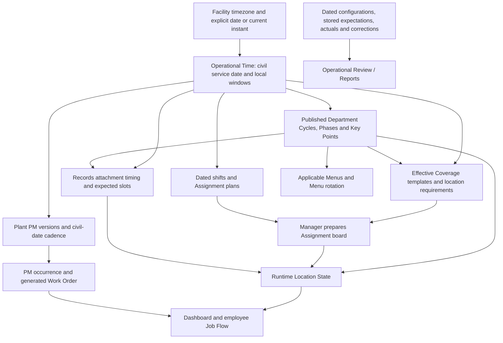
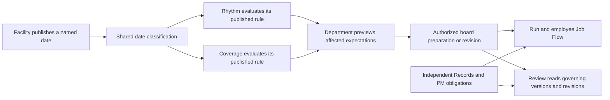
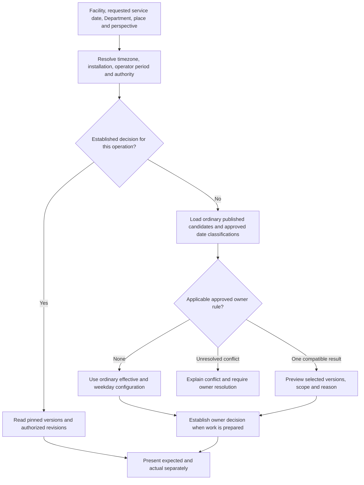
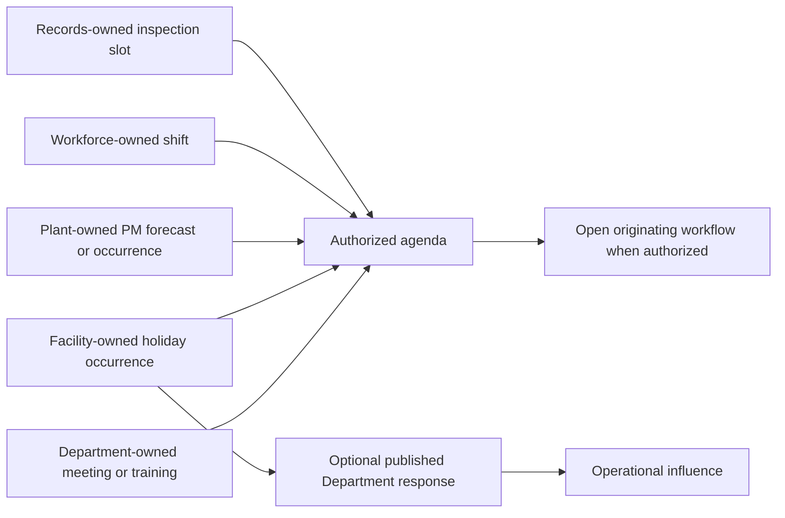

# Vssyl Platform Calendar & Temporal Architecture Audit

> **Historical evidence · CAL-00 · accepted as discovery.** The report below preserves the original audit, including its recommendations and verification limits. The five phases in its final section were provisional at discovery. The [program tracker](PHASE_TRACKER.md) now records CAL-00 through CAL-08 and the authorized scope. Relative source links open the repository files. Adjacent line links open the exact audited revision. The two design-only Cafeteria references link to the copy subsequently preserved on its own branch.

**Phase 0 verdict — RECOMMENDED WITH PREREQUISITES**

Vssyl has a demonstrated platform gap. It can determine the facility’s service date, select published operating cycles, calculate Coverage requirements, and prepare a dated Assignment board. I found no shared fact that identifies a date as Thanksgiving, records a planned closure, or explains why one Department should use different operating expectations on that date.

**I recommend Option C first:** define a small, shared facility date-classification capability and let an authorized Department preview its effect on published Rhythm and Coverage. The first useful result is a manager being able to see *which rooms, hours, and staffing requirements would change, which would continue, and why*. Keep manual Assignment boards available. Advance to operational use only after preview, application, Run, and Review agree on the same date and decision. An integrated calendar with events and projections is a viable longer-term direction under Option D.

A full calendar interface is unnecessary to prove that first use case. Conversely, a calendar that only displays “Thanksgiving” would leave the original Cafeteria problem unresolved. The existing architecture already gives the future calendar a place as a consumer of domain-owned information. **Giving a date classification influence over operations is the new architectural decision requiring approval.** [Accepted temporal contract](../../docs/product/01B_PHASE_1_ARCHITECTURE_CONTRACTS_AMENDMENT_2026-11-08.md) ([L155](https://github.com/ADTrauts/LTC-Manager/blob/9f3388ac5c5d46a25567229a8ad2f9970dc618ec/docs/product/01B_PHASE_1_ARCHITECTURE_CONTRACTS_AMENDMENT_2026-11-08.md?plain=1#L155)) · [Platform rules for new primitives and engines](../../docs/product/15_PLATFORM_PRIMITIVES_AND_ENGINES_REGISTRY.md) ([L120](https://github.com/ADTrauts/LTC-Manager/blob/9f3388ac5c5d46a25567229a8ad2f9970dc618ec/docs/product/15_PLATFORM_PRIMITIVES_AND_ENGINES_REGISTRY.md?plain=1#L120))

## Audit scope and evidence

I located the assigned checkout at the repository root (`.`). Its own `AGENTS.md` identifies it as the shared Codex/Cursor checkout for **Vssyl — Current Operations**. The Git origin is `ADTrauts/LTC-Manager`. At entry, the checkout was clean on `main` at `9f3388ac5c5d46a25567229a8ad2f9970dc618ec`, matching its local `origin/main` reference. All implementation findings below use that commit. [Repository identity and assignment](../../AGENTS.md) ([L19](https://github.com/ADTrauts/LTC-Manager/blob/9f3388ac5c5d46a25567229a8ad2f9970dc618ec/AGENTS.md?plain=1#L19)) · [Audited commit](https://github.com/ADTrauts/LTC-Manager/commit/9f3388ac5c5d46a25567229a8ad2f9970dc618ec)

During the audit, another editor switched the shared folder to `docs/cafeteria-dining-blueprint` at the same commit and changed five documentation files. I verified that application source, schema, tests, and deployment configuration still matched the audited commit. The new local Cafeteria blueprint explicitly identifies alternate station sets and hours as a holiday need. It also identifies Cafeteria Dining as **unregistered**. I used it as evidence of the design use case, separate from shipped behavior. [Cafeteria blueprint status](https://github.com/ADTrauts/LTC-Manager/blob/b82586f30b062fa19b682429415ff73a529ee30d/docs/product/18_CAFETERIA_DINING.md?plain=1#L3) · [Blueprint’s platform-gap assessment](https://github.com/ADTrauts/LTC-Manager/blob/b82586f30b062fa19b682429415ff73a529ee30d/docs/product/18_CAFETERIA_DINING.md?plain=1#L51)

**Verification:** 164 existing tests passed across 16 selected test files, with zero failures or skips. I ran them in memory with filesystem writes disabled. I also directly exercised the date-conversion functions described below. Database and browser integration tests are cited as inspected evidence where relevant. Hosted scheduler activity, production data, and production flag values were outside this audit. I made no file, schema, migration, documentation, data, or behavior changes.

The inventory and current-state diagram describe code at the audited commit. An *approved target* is a decision supported by governing documentation. A *gap* means I found no implementation after tracing the relevant schema, owners, routes, consumers, and tests. The proposed diagrams, options, and prerequisites are architectural judgments.

## 1. What the current architecture establishes

| Earlier premise | Finding in current Vssyl |
|---|---|
| The older LTC Manager guidebook defines the implementation | The current Constitution, accepted amendments, documentation status register, and owning code govern. The historical guidebook remains useful for intent. [Constitution](../../docs/product/01_PRODUCT_CONSTITUTION.md) ([L15](https://github.com/ADTrauts/LTC-Manager/blob/9f3388ac5c5d46a25567229a8ad2f9970dc618ec/docs/product/01_PRODUCT_CONSTITUTION.md?plain=1#L15)) · [Superseded guidance](../../docs/DOCUMENTATION_STATUS.md) ([L25](https://github.com/ADTrauts/LTC-Manager/blob/9f3388ac5c5d46a25567229a8ad2f9970dc618ec/docs/DOCUMENTATION_STATUS.md?plain=1#L25)) |
| A Product and a Department are interchangeable scopes | A Product is the Vssyl-authored operating model. A Department is its local installed instance, with its own operator, authority, people, and places. `DIETARY` is the installation key for Food and Nutrition. The registry also lists EVS and Facility Plant Operations as available. It contains no separate Cafeteria or Residential Dining Product. [Product contract](../../docs/product/13_DEPARTMENT_PRODUCT.md) ([L38](https://github.com/ADTrauts/LTC-Manager/blob/9f3388ac5c5d46a25567229a8ad2f9970dc618ec/docs/product/13_DEPARTMENT_PRODUCT.md?plain=1#L38)) · [Product registry](../../src/lib/department-products/registry.ts) ([L117](https://github.com/ADTrauts/LTC-Manager/blob/9f3388ac5c5d46a25567229a8ad2f9970dc618ec/src/lib/department-products/registry.ts#L117)) |
| Rhythm and Coverage both have selectable weekday, weekend, and holiday profiles | Rhythm has weekday-scoped, effective-dated Cycles. Coverage has versioned requirements for explicit locations, optionally bound to Cycle keys. Multiple valid requirements can apply together. I found no shared named-profile switch and no separate holiday condition on Coverage. [Cycle selection](../../src/lib/operational-cycles/load-published-cycles.ts) ([L105](https://github.com/ADTrauts/LTC-Manager/blob/9f3388ac5c5d46a25567229a8ad2f9970dc618ec/src/lib/operational-cycles/load-published-cycles.ts#L105)) · [Coverage selection](../../src/lib/scheduling/coverage-expectations/publication.ts) ([L103](https://github.com/ADTrauts/LTC-Manager/blob/9f3388ac5c5d46a25567229a8ad2f9970dc618ec/src/lib/scheduling/coverage-expectations/publication.ts#L103)) · [Location and Cycle matching](../../src/lib/scheduling/coverage-expectations/match-expectation.ts) ([L44](https://github.com/ADTrauts/LTC-Manager/blob/9f3388ac5c5d46a25567229a8ad2f9970dc618ec/src/lib/scheduling/coverage-expectations/match-expectation.ts#L44)) |
| Work Plans, Tasks, and Today’s Work should integrate with a calendar | Generic Work Plans and replacement catch-all Tasks are retired. One-off employee responsibilities belong with explicit Assignments. Records own scheduled inspections, Plant owns maintenance execution, and employee Job Flow composes the relevant facts. `/today` redirects to Dashboard. [Accepted retirement and one-off decisions](../../docs/product/01C_PRELAUNCH_CANONICAL_RESET_AMENDMENT_2026-11-10.md) ([L42](https://github.com/ADTrauts/LTC-Manager/blob/9f3388ac5c5d46a25567229a8ad2f9970dc618ec/docs/product/01C_PRELAUNCH_CANONICAL_RESET_AMENDMENT_2026-11-10.md?plain=1#L42)) · [Today route](../../src/app/%28protected%29/today/page.tsx) ([L3](https://github.com/ADTrauts/LTC-Manager/blob/9f3388ac5c5d46a25567229a8ad2f9970dc618ec/src/app/%28protected%29/today/page.tsx#L3)) |
| A calendar needs a new recurrence engine, clock, or history ledger | The accepted contract preserves domain recurrence and defines the future unified timeline as a projection. The committed deployment configuration registers the five-minute Scheduled Evaluation route and a separate daily Plant PM generation route. The five-minute handler checks an enable switch. This supersedes the older audit’s statement that the route was unregistered. [Temporal contract](../../docs/product/01B_PHASE_1_ARCHITECTURE_CONTRACTS_AMENDMENT_2026-11-08.md) ([L155](https://github.com/ADTrauts/LTC-Manager/blob/9f3388ac5c5d46a25567229a8ad2f9970dc618ec/docs/product/01B_PHASE_1_ARCHITECTURE_CONTRACTS_AMENDMENT_2026-11-08.md?plain=1#L155)) · [Deployment schedules](../../vercel.json) ([L3](https://github.com/ADTrauts/LTC-Manager/blob/9f3388ac5c5d46a25567229a8ad2f9970dc618ec/vercel.json#L3)) · [Execution gate](../../src/lib/scheduled-evaluation/cron.ts) ([L28](https://github.com/ADTrauts/LTC-Manager/blob/9f3388ac5c5d46a25567229a8ad2f9970dc618ec/src/lib/scheduled-evaluation/cron.ts#L28)) |

### Current temporal architecture — code verified

## 2. Temporal inventory and integration matrix

“Consumes” and “projects” below are recommended directions for a future calendar. **No row currently consumes shared holiday context.** The entry points are implemented unless identified as retired, partial, or proposed.

| Capability | Current owner | Consumes calendar context | Projects calendar information | Existing integration point | Required extension | Architectural risk |
|---|---|---|---|---|---|---|
| Facility time and service date | Facility + Operational Time | Supplies the date and zone to calendar | Local date and interval boundaries | `Facility.timezone`, `loadFacilityTimezone`, `getFacilityServiceDate`. Civil date is represented as `YYYY-MM-DD` or a UTC-midnight database date. [Time API](../../src/lib/operational-time/index.ts) ([L16](https://github.com/ADTrauts/LTC-Manager/blob/9f3388ac5c5d46a25567229a8ad2f9970dc618ec/src/lib/operational-time/index.ts#L16)) | Pass the requested date and timezone explicitly | Treating the UTC date key as the instant local operations begin |
| Facility, Department, Product, Location | Facility Builder, Product installation, Department authority | Supplies scope and authority | Relevant installed Department and canonical Unit/Space | `UnitDepartmentResponsibility`, `UnitSpaceResponsibility`, `savePhysicalResponsibility`, Product registry. [Facility ownership](../../src/lib/facility-builder/responsibility-service.ts) ([L6](https://github.com/ADTrauts/LTC-Manager/blob/9f3388ac5c5d46a25567229a8ad2f9970dc618ec/src/lib/facility-builder/responsibility-service.ts#L6)) · [Space responsibility](../../prisma/schema.prisma) ([L2030](https://github.com/ADTrauts/LTC-Manager/blob/9f3388ac5c5d46a25567229a8ad2f9970dc618ec/prisma/schema.prisma#L2030)) | Reference existing IDs and affected recipients | Inferring authority from Product, location, room type, or department filter |
| Rhythm, Cycles, Phases, Key Points | Department Builder → Operating Rhythm | Yes, for explicitly approved alternate operating patterns | Published windows, Key Points, forthcoming activation | `DepartmentOperationalCycle`, `loadPublishedCyclesForDate`, `resolveOperationalCycle`. Inclusive date ranges, weekday set, local wall times, optional overnight span. [Loader](../../src/lib/operational-cycles/load-published-cycles.ts) ([L105](https://github.com/ADTrauts/LTC-Manager/blob/9f3388ac5c5d46a25567229a8ad2f9970dc618ec/src/lib/operational-cycles/load-published-cycles.ts#L105)) · [Resolver](../../src/lib/operational-cycles/resolve-operational-cycle.ts) ([L203](https://github.com/ADTrauts/LTC-Manager/blob/9f3388ac5c5d46a25567229a8ad2f9970dc618ec/src/lib/operational-cycles/resolve-operational-cycle.ts#L203)) | Select an approved set before normal weekday filtering discards candidates | Treating overlapping legitimate Phases as competing holiday rules |
| Coverage | People & Coverage | Yes, for an approved alternate need | Required role, place, period, count | `OperationalAssignmentTemplate` and items. Runtime chooses an effective published version per stable key and matches Unit/Space and optional Cycle. [Publication](../../src/lib/scheduling/coverage-expectations/publication.ts) ([L103](https://github.com/ADTrauts/LTC-Manager/blob/9f3388ac5c5d46a25567229a8ad2f9970dc618ec/src/lib/scheduling/coverage-expectations/publication.ts#L103)) · [Matching](../../src/lib/scheduling/coverage-expectations/match-expectation.ts) ([L21](https://github.com/ADTrauts/LTC-Manager/blob/9f3388ac5c5d46a25567229a8ad2f9970dc618ec/src/lib/scheduling/coverage-expectations/match-expectation.ts#L21)) | Define which requirements an alternative replaces or retains | Adding “holiday” requirements on top of ordinary ones and double-counting |
| Employee schedules and attendance | Workforce | Awareness by default | Authorized shifts and call-offs | `WorkShift`, `ScheduleEntry`, planned local start/end, date and call-off. Copy-to-days creates dated shifts. Overnight shifts end on the next civil day. Review expressly declines to infer attendance. [Shift copy](../../src/lib/scheduling/canonical-shift-service.ts) ([L228](https://github.com/ADTrauts/LTC-Manager/blob/9f3388ac5c5d46a25567229a8ad2f9970dc618ec/src/lib/scheduling/canonical-shift-service.ts#L228)) · [Overnight rule](../../src/lib/scheduling/shift-clock-time.ts) ([L37](https://github.com/ADTrauts/LTC-Manager/blob/9f3388ac5c5d46a25567229a8ad2f9970dc618ec/src/lib/scheduling/shift-clock-time.ts#L37)) · [Attendance test](../../src/lib/operational-review/compose-operational-review-day.hermetic.test.ts) ([L462](https://github.com/ADTrauts/LTC-Manager/blob/9f3388ac5c5d46a25567229a8ad2f9970dc618ec/src/lib/operational-review/compose-operational-review-day.hermetic.test.ts#L462)) | Restrict personal projections to authorized viewers | Equating a scheduled person with actual attendance or filled Coverage |
| Assignments and boards | Workforce / authorized Run manager | Through resolved Coverage and an explicit plan revision | Dated board status and permitted placements | `OperationalAssignmentPlan` is unique by facility, Department, and service date. `OperationalAssignment` records person, role, location and optional instant bounds. `OperationalAssignmentEvent` records changes. [Plan model](../../prisma/schema.prisma) ([L3353](https://github.com/ADTrauts/LTC-Manager/blob/9f3388ac5c5d46a25567229a8ad2f9970dc618ec/prisma/schema.prisma#L3353)) · [Template application](../../src/lib/scheduling/operational-assignments/apply-assignment-template.ts) ([L21](https://github.com/ADTrauts/LTC-Manager/blob/9f3388ac5c5d46a25567229a8ad2f9970dc618ec/src/lib/scheduling/operational-assignments/apply-assignment-template.ts#L21)) | Give preview, apply, and revision the same governing selection | A cancellation silently moving employees or invalidating a confirmed board |
| Work Plans and Tasks | Retired generic Work; responsibility rehomed by domain | None | Use the owning Assignment, Record, or Plant work item | The old scheduled-inspection generator returns zero created tasks and occurrences. [Retirement contract](../../AGENTS.md) ([L67](https://github.com/ADTrauts/LTC-Manager/blob/9f3388ac5c5d46a25567229a8ad2f9970dc618ec/AGENTS.md?plain=1#L67)) · [Retired generator](../../src/lib/work/inspections/generate-due-inspection-work.ts) ([L80](https://github.com/ADTrauts/LTC-Manager/blob/9f3388ac5c5d46a25567229a8ad2f9970dc618ec/src/lib/work/inspections/generate-due-inspection-work.ts#L80)) | None for generic Work | Reviving a second work engine through calendar entries |
| Evidence, Logs, inspections | Records Catalog → facility install → `LogAttachment` → derived slot → `OperationalEvidenceRecord` | Only when its own configured obligation depends on an affected Cycle | Authorized expected slots, submitted Records, inspection due information | `resolveLogRequirementsForAttachment` handles ad hoc, Cycle-bound, daily windows, and daily/weekly/monthly calendar cadence. Month-end is clamped. Submission pins evidence and timing. [Requirement resolver](../../src/lib/canonical-logs/resolve-log-requirements.ts) ([L174](https://github.com/ADTrauts/LTC-Manager/blob/9f3388ac5c5d46a25567229a8ad2f9970dc618ec/src/lib/canonical-logs/resolve-log-requirements.ts#L174)) · [Calendar cadence](../../src/lib/canonical-logs/resolve-log-requirements.ts) ([L416](https://github.com/ADTrauts/LTC-Manager/blob/9f3388ac5c5d46a25567229a8ad2f9970dc618ec/src/lib/canonical-logs/resolve-log-requirements.ts#L416)) · [Submission snapshot](../../src/lib/canonical-logs/submit-canonical-log.ts) ([L503](https://github.com/ADTrauts/LTC-Manager/blob/9f3388ac5c5d46a25567229a8ad2f9970dc618ec/src/lib/canonical-logs/submit-canonical-log.ts#L503)) | Inventory the actual dependency of each affected slot | A closure suppressing a cooler check, inspection, or independent obligation |
| Assets, Issues, maintenance requests | Asset Operations and receiving Department | Awareness of planned impact | Selected planned impact or authorized source status | `changeAssetStatus` records actual condition. `OperationalRequest` has a requester-safe view. Asset condition and observed Issue times have different meanings from a planned outage. [Asset status](../../src/lib/asset-operations/asset-service.ts) ([L429](https://github.com/ADTrauts/LTC-Manager/blob/9f3388ac5c5d46a25567229a8ad2f9970dc618ec/src/lib/asset-operations/asset-service.ts#L429)) · [Requester view](../../src/lib/operational-requests/request-service.ts) ([L711](https://github.com/ADTrauts/LTC-Manager/blob/9f3388ac5c5d46a25567229a8ad2f9970dc618ec/src/lib/operational-requests/request-service.ts#L711)) | Add an explicit planned impact interval and audience where necessary | Announcing a future shutdown as equipment already out of service |
| Work Orders | Plant / authorized maintenance owner | Independent unless Plant explicitly revises its work | Planning date, deadline, assigned work | `Repair.targetDate` and `dueAt` serve different purposes. `recordWorkOrderDeadline` owns deadline changes. For generated PM work the deadline is the following facility-local midnight. [PM Work Order dates](../../src/lib/preventive-maintenance/work-order-create.ts) ([L314](https://github.com/ADTrauts/LTC-Manager/blob/9f3388ac5c5d46a25567229a8ad2f9970dc618ec/src/lib/preventive-maintenance/work-order-create.ts#L314)) · [Deadline owner](../../src/lib/asset-operations/work-order-service.ts) ([L696](https://github.com/ADTrauts/LTC-Manager/blob/9f3388ac5c5d46a25567229a8ad2f9970dc618ec/src/lib/asset-operations/work-order-service.ts#L696)) | Label the date type and link to the source | Moving a displayed item accidentally changing a deadline |
| Preventive Maintenance | Plant PM | Independent by default | Forecast and materialized occurrences | `projectPmSchedule` uses effective versions, an anchor civil date, and a month interval. `loadPmRunBoard` already merges a 12-month forecast with stored occurrences. Generation pins `planVersionId` and enforces one occurrence per plan/date. [Projection](../../src/lib/preventive-maintenance/schedule.ts) ([L167](https://github.com/ADTrauts/LTC-Manager/blob/9f3388ac5c5d46a25567229a8ad2f9970dc618ec/src/lib/preventive-maintenance/schedule.ts#L167)) · [Run board](../../src/lib/preventive-maintenance/run-load.ts) ([L254](https://github.com/ADTrauts/LTC-Manager/blob/9f3388ac5c5d46a25567229a8ad2f9970dc618ec/src/lib/preventive-maintenance/run-load.ts#L254)) · [Materialization](../../src/lib/preventive-maintenance/generator.ts) ([L61](https://github.com/ADTrauts/LTC-Manager/blob/9f3388ac5c5d46a25567229a8ad2f9970dc618ec/src/lib/preventive-maintenance/generator.ts#L61)) | Add a bounded, authorized calendar reader over the same rules | Duplicating a forecast, its occurrence, and its generated Work Order |
| Menus and production | Food and Nutrition Menus; Rhythm owns service timing | Only through explicitly approved Menu or Cycle applicability | Rotating menus and applicable meal periods | `MenuCycleSettings` and `MenuItem` use a rotation anchor and week start. `resolveApplicableMenus` requires an exact location and date-effective root Cycle, and may return multiple menus. No independent meal-production scheduling owner was found. [Rotation](../../src/lib/menu-cycle.ts) ([L168](https://github.com/ADTrauts/LTC-Manager/blob/9f3388ac5c5d46a25567229a8ad2f9970dc618ec/src/lib/menu-cycle.ts#L168)) · [Runtime lookup](../../src/lib/menu-runtime-db.ts) ([L245](https://github.com/ADTrauts/LTC-Manager/blob/9f3388ac5c5d46a25567229a8ad2f9970dc618ec/src/lib/menu-runtime-db.ts#L245)) | Version Menu decisions before promising historical holiday menus | Picking one “winning” Menu or presenting current content as past production |
| Runtime Location State | Read-only composition of operational owners | Through the selected owner facts | Displays an approved closure or adjusted window in context | `prefetchRuntimeLocationInputs` and `composeRuntimeLocationStates` combine Rhythm, Assignments, Coverage, Records and asset facts. [Prefetch](../../src/lib/runtime-location-state/prefetch.ts) ([L98](https://github.com/ADTrauts/LTC-Manager/blob/9f3388ac5c5d46a25567229a8ad2f9970dc618ec/src/lib/runtime-location-state/prefetch.ts#L98)) · [Composition](../../src/lib/runtime-location-state/compose.ts) ([L610](https://github.com/ADTrauts/LTC-Manager/blob/9f3388ac5c5d46a25567229a8ad2f9970dc618ec/src/lib/runtime-location-state/compose.ts#L610)) | Align the requested date across all readers | Mixing today’s Rhythm with another date’s board |
| Dashboard, Today’s Work, employee Job Flow | Dashboard and employee-facing compositions | Only relevant, authorized results | Upcoming impacts for a manager; actionable changes for the assigned employee | Dashboard consumes scoped facts. Job Flow composes Assignments, Records, call-offs and assigned Plant Work Orders. It deliberately leaves the separate PM list empty once execution belongs to a Work Order. [Dashboard](../../src/lib/dashboard/facts.ts) ([L190](https://github.com/ADTrauts/LTC-Manager/blob/9f3388ac5c5d46a25567229a8ad2f9970dc618ec/src/lib/dashboard/facts.ts#L190)) · [Job Flow](../../src/lib/employee-runtime-flow/load-flow.ts) ([L244](https://github.com/ADTrauts/LTC-Manager/blob/9f3388ac5c5d46a25567229a8ad2f9970dc618ec/src/lib/employee-runtime-flow/load-flow.ts#L244)) | Show source-backed changes in existing surfaces | Duplicate actions or a private facility-wide feed on a shared tablet |
| Operational Review and offline runtime | Audit / Reports; offline issuance and receipt owners | The established decision and later authorized revisions | Historical explanation; relevant issued context offline | Review reconstructs date-effective facts. Offline replay checks identity, scope, target, baseline, authority and prior receipts. [Review composer](../../src/lib/operational-review/compose-operational-review-day.ts) ([L216](https://github.com/ADTrauts/LTC-Manager/blob/9f3388ac5c5d46a25567229a8ad2f9970dc618ec/src/lib/operational-review/compose-operational-review-day.ts#L216)) · [Offline replay](../../src/lib/offline/space/service.ts) ([L205](https://github.com/ADTrauts/LTC-Manager/blob/9f3388ac5c5d46a25567229a8ad2f9970dc618ec/src/lib/offline/space/service.ts#L205)) | Retain the decision revision in the affected owner’s history and offline baseline | Reinterpreting a past day or accepting stale offline intent |
| Scheduled Evaluation and Notifications | Shared clock and Notifications & Attention | Only resulting domain transitions | Existing attention on a genuine change | `listScheduledEvaluators` covers Coverage, overdue Key Points, Work Orders and notification processing. PM generation has its own existing domain job. [Evaluator registry](../../src/lib/scheduled-evaluation/registry.ts) ([L17](https://github.com/ADTrauts/LTC-Manager/blob/9f3388ac5c5d46a25567229a8ad2f9970dc618ec/src/lib/scheduled-evaluation/registry.ts#L17)) | Reuse existing channels for approved changes if needed | A second scheduler or an alert for every informational event |

### Calendar functionality found under other names

The **PM Run board** is the strongest reusable calendar example. It distinguishes a forecast from a stored occurrence, knows the governing version, and gives the materialized occurrence precedence. The **weekly staffing grid**, **Cycle timeline**, **Records calendar cadence**, and **Menu rotation** are narrower implementations with valid owners. A unified display could share their projections, but their source owners and editing workflows would still be needed. [Staffing week projection](../../src/lib/scheduling/department-week-schedule-projection.ts) · [Cycle timeline](../../src/lib/operational-cycles/cycle-timeline.ts) ([L14](https://github.com/ADTrauts/LTC-Manager/blob/9f3388ac5c5d46a25567229a8ad2f9970dc618ec/src/lib/operational-cycles/cycle-timeline.ts#L14)) · [PM projection deduplication](../../src/lib/preventive-maintenance/run-load.ts) ([L358](https://github.com/ADTrauts/LTC-Manager/blob/9f3388ac5c5d46a25567229a8ad2f9970dc618ec/src/lib/preventive-maintenance/run-load.ts#L358))

The “Holiday Supplement” in Menu tests is a co-applicable menu name. It has no holiday trigger. `RoomAreaStatus` records a dated unit condition such as clean, occupied, or isolation. `Facility.operationsSuspendedAt` is a live facility-wide administrative pause that affects operational writes, including offline preparation. None provides a scheduled, scoped retail closure. [Menu overlap example](../../src/lib/menu-runtime.hermetic.test.ts) ([L299](https://github.com/ADTrauts/LTC-Manager/blob/9f3388ac5c5d46a25567229a8ad2f9970dc618ec/src/lib/menu-runtime.hermetic.test.ts#L299)) · [Room status values](../../prisma/schema.prisma) ([L1750](https://github.com/ADTrauts/LTC-Manager/blob/9f3388ac5c5d46a25567229a8ad2f9970dc618ec/prisma/schema.prisma#L1750)) · [Facility suspension](../../src/lib/offline/build-runtime-bundle.ts) ([L114](https://github.com/ADTrauts/LTC-Manager/blob/9f3388ac5c5d46a25567229a8ad2f9970dc618ec/src/lib/offline/build-runtime-bundle.ts#L114))

**Genuine gaps:** I found no shared authored facility or Department event lifecycle, actual-versus-observed holiday occurrence, planned multi-Department closure, general blackout or exception-date rule, or explanation of why a particular date and scope selected an alternative. There is no implemented cross-domain timeline, general event-recurrence service, or combined operating-profile artifact. The unified timeline is an approved target. The new date-classification and operational-influence contracts remain proposals. I found no production holiday engine to retire. [Authoritative status register](../../docs/DOCUMENTATION_STATUS.md) ([L14](https://github.com/ADTrauts/LTC-Manager/blob/9f3388ac5c5d46a25567229a8ad2f9970dc618ec/docs/DOCUMENTATION_STATUS.md?plain=1#L14)) · [Temporal ownership contract](../../docs/product/01B_PHASE_1_ARCHITECTURE_CONTRACTS_AMENDMENT_2026-11-08.md) ([L155](https://github.com/ADTrauts/LTC-Manager/blob/9f3388ac5c5d46a25567229a8ad2f9970dc618ec/docs/product/01B_PHASE_1_ARCHITECTURE_CONTRACTS_AMENDMENT_2026-11-08.md?plain=1#L155))

## 3. How a service date actually resolves

1. **Resolve the date and the user’s scope.** Operational Time maps an instant to the facility’s local civil day. A stored UTC-midnight service date is a date key. I found no configurable Department operating-day boundary. Department membership, operator period, Product installation, and responsible places are resolved separately. An explicit date is essential for forward planning. [Service-date conversion](../../src/lib/operational-time/service-date.ts) ([L8](https://github.com/ADTrauts/LTC-Manager/blob/9f3388ac5c5d46a25567229a8ad2f9970dc618ec/src/lib/operational-time/service-date.ts#L8)) · [Department access map](../../src/lib/department-authority/resolve.ts) ([L157](https://github.com/ADTrauts/LTC-Manager/blob/9f3388ac5c5d46a25567229a8ad2f9970dc618ec/src/lib/department-authority/resolve.ts#L157))
2. **Read published Rhythm applicable to that date.** `loadPublishedCyclesForDate` filters facility, Department, inclusive effective interval, publication state, and weekday. It admits bounded retired versions for their historical dates. `resolveOperationalCycle` then uses applicable place, hierarchy, and instant to identify active periods and phases. Overlap between distinct Cycles can be legitimate. Publishing can establish a future effective date and end a predecessor’s interval; same-day paths also exist. [Date and weekday selection](../../src/lib/operational-cycles/load-published-cycles.ts) ([L116](https://github.com/ADTrauts/LTC-Manager/blob/9f3388ac5c5d46a25567229a8ad2f9970dc618ec/src/lib/operational-cycles/load-published-cycles.ts#L116)) · [Publication](../../src/lib/operational-cycles/cycle-service.ts) ([L982](https://github.com/ADTrauts/LTC-Manager/blob/9f3388ac5c5d46a25567229a8ad2f9970dc618ec/src/lib/operational-cycles/cycle-service.ts#L982)) · [Overlap semantics](../../src/lib/operational-cycles/validate-cycle.ts) ([L92](https://github.com/ADTrauts/LTC-Manager/blob/9f3388ac5c5d46a25567229a8ad2f9970dc618ec/src/lib/operational-cycles/validate-cycle.ts#L92))
3. **Resolve Coverage and prepare the board.** Coverage publication generally takes effect no earlier than the next facility day. Multiple published stable keys can contribute requirements. The board joins dated shifts and placements; authorized template application rechecks the persisted requirement and employee eligibility. A manual board can allocate staff for a holiday today. It cannot by itself change what Rhythm, Coverage, or Records say was expected. [Coverage effective-date rule](../../src/lib/scheduling/coverage-expectations/publication.ts) ([L167](https://github.com/ADTrauts/LTC-Manager/blob/9f3388ac5c5d46a25567229a8ad2f9970dc618ec/src/lib/scheduling/coverage-expectations/publication.ts#L167)) · [Daily board](../../src/lib/scheduling/operational-assignments/load-daily-assignment-board.ts) ([L29](https://github.com/ADTrauts/LTC-Manager/blob/9f3388ac5c5d46a25567229a8ad2f9970dc618ec/src/lib/scheduling/operational-assignments/load-daily-assignment-board.ts#L29))
4. **Resolve other obligations in parallel.** Records resolves each attachment’s timing and target. Menus reads effective root Cycles and its own content. PM projects from its own versions. These are separate branches. A universal sequence from Rhythm through Coverage through “Work” to all evidence would misrepresent the implementation. [Records timing modes](../../src/lib/canonical-logs/resolve-log-requirements.ts) ([L242](https://github.com/ADTrauts/LTC-Manager/blob/9f3388ac5c5d46a25567229a8ad2f9970dc618ec/src/lib/canonical-logs/resolve-log-requirements.ts#L242)) · [Menu resolver](../../src/lib/menu-runtime-db.ts) ([L259](https://github.com/ADTrauts/LTC-Manager/blob/9f3388ac5c5d46a25567229a8ad2f9970dc618ec/src/lib/menu-runtime-db.ts#L259)) · [PM schedule](../../src/lib/preventive-maintenance/schedule.ts) ([L167](https://github.com/ADTrauts/LTC-Manager/blob/9f3388ac5c5d46a25567229a8ad2f9970dc618ec/src/lib/preventive-maintenance/schedule.ts#L167))
5. **Compose Run and reconstruct Review differently.** Run asks what is actionable now. Historical Review reads stored facts and effective versions, and overlays live Runtime Location State only for today. Review’s range validator rejects future dates and caps a range at 31 days. Neither surface is a ready-made arbitrary-date planning engine. [Run model](../../src/lib/operational-cycles/load-run-operation-presentation.ts) ([L40](https://github.com/ADTrauts/LTC-Manager/blob/9f3388ac5c5d46a25567229a8ad2f9970dc618ec/src/lib/operational-cycles/load-run-operation-presentation.ts#L40)) · [Reports overlay](../../src/app/%28protected%29/reports/page.tsx) ([L178](https://github.com/ADTrauts/LTC-Manager/blob/9f3388ac5c5d46a25567229a8ad2f9970dc618ec/src/app/%28protected%29/reports/page.tsx#L178)) · [Review range](../../src/lib/operational-review/service-date-range.ts) ([L10](https://github.com/ADTrauts/LTC-Manager/blob/9f3388ac5c5d46a25567229a8ad2f9970dc618ec/src/lib/operational-review/service-date-range.ts#L10))

**Best insertion point:** after determining facility date and authorized operational scope, but before each participating owner finalizes candidate applicability. A Saturday special opening cannot recover its alternative Cycle if the ordinary weekday filter has already removed it. A small shared lookup can return the approved classification and its version. Rhythm and Coverage must each decide what their own published configuration means. Operational Time should continue to answer *when*. There is currently no single contract that answers *which configuration governed, for which owner, and why*.

### Three verified obstacles to operational influence

- **Future preview can mix dates.** Runtime prefetch accepts an `operationalDateKey` for dated facts but calls `loadPublishedRunModel` with `now`. That reader derives today’s Rhythm again. The Assignment page also defaults an omitted date using the server’s local midnight. Use date-explicit owner readers for a preview and verify that every displayed component used the requested date. [Prefetch call](../../src/lib/runtime-location-state/prefetch.ts) ([L207](https://github.com/ADTrauts/LTC-Manager/blob/9f3388ac5c5d46a25567229a8ad2f9970dc618ec/src/lib/runtime-location-state/prefetch.ts#L207)) · [Run date derivation](../../src/lib/operational-cycles/load-run-operation-presentation.ts) ([L45](https://github.com/ADTrauts/LTC-Manager/blob/9f3388ac5c5d46a25567229a8ad2f9970dc618ec/src/lib/operational-cycles/load-run-operation-presentation.ts#L45)) · [Board date default](../../src/app/%28protected%29/staffing/assignments/page.tsx) ([L45](https://github.com/ADTrauts/LTC-Manager/blob/9f3388ac5c5d46a25567229a8ad2f9970dc618ec/src/app/%28protected%29/staffing/assignments/page.tsx#L45))
- **Coverage summary, Assignment preview, and application do not evaluate identical rules.** The Coverage summary matches items against the relevant Cycles. Template preview iterates the effective template’s items without reading their Cycle bindings. Application validates the template, person, and place without independently establishing that the item’s Cycle applies on that date. An automatic “apply holiday profile” action through this path could prepare positions the Coverage view does not expect. [Coverage summary](../../src/lib/scheduling/operational-assignments/build-coverage-summary.ts) ([L227](https://github.com/ADTrauts/LTC-Manager/blob/9f3388ac5c5d46a25567229a8ad2f9970dc618ec/src/lib/scheduling/operational-assignments/build-coverage-summary.ts#L227)) · [Template preview](../../src/lib/scheduling/operational-assignments/load-assignment-template-preview.ts) ([L21](https://github.com/ADTrauts/LTC-Manager/blob/9f3388ac5c5d46a25567229a8ad2f9970dc618ec/src/lib/scheduling/operational-assignments/load-assignment-template-preview.ts#L21)) · [Template application](../../src/lib/scheduling/operational-assignments/apply-assignment-template.ts) ([L32](https://github.com/ADTrauts/LTC-Manager/blob/9f3388ac5c5d46a25567229a8ad2f9970dc618ec/src/lib/scheduling/operational-assignments/apply-assignment-template.ts#L32))
- **Overnight arithmetic works in one owner and fails in another.** In a direct read-only probe for November 26, 2026, Rhythm accepted 10 p.m.–6 a.m. in New York and produced the correct next-day end. Assignment-template window validation rejected the same local times. In Auckland, asking the Assignment parser for 8 a.m. on November 26 produced 8 a.m. local on **November 27**. The parser uses noon UTC as a proxy for the requested local date. Plant’s on-call lookup already provides a partial reuse example by checking bounded Assignments from the preceding service date. [Assignment conversion and validation](../../src/lib/scheduling/operational-assignments/responsibility-window.ts) ([L11](https://github.com/ADTrauts/LTC-Manager/blob/9f3388ac5c5d46a25567229a8ad2f9970dc618ec/src/lib/scheduling/operational-assignments/responsibility-window.ts#L11)) · [Rhythm DST and date-line tests](../../src/lib/operational-cycles/cycle-windows.hermetic.test.ts) ([L56](https://github.com/ADTrauts/LTC-Manager/blob/9f3388ac5c5d46a25567229a8ad2f9970dc618ec/src/lib/operational-cycles/cycle-windows.hermetic.test.ts#L56)) · [On-call lookup](../../src/lib/scheduling/operational-assignments/resolve-operational-response.ts) ([L48](https://github.com/ADTrauts/LTC-Manager/blob/9f3388ac5c5d46a25567229a8ad2f9970dc618ec/src/lib/scheduling/operational-assignments/resolve-operational-response.ts#L48))

## 4. Proposed ownership and authority

| Question | Proposed owner or rule |
|---|---|
| Who owns the event? | A facility publisher owns a facility observance. A Department owns a meeting it authors. Plant owns maintenance and its source schedule. Each fact has one owner. |
| Who can view it? | Resolve tenancy and server-side audience before returning titles, counts, times, locations, or links. Private Department items stay within authorized detail scope. For cross-Department impacts, publish a deliberately shareable notice containing the affected place, interval, and operational impact. |
| Who can create, modify, publish, or cancel it? | A principal authorized for the source and operation. Drafting, publishing a facility fact, canceling an occurrence, editing a PM plan, and revising a Department plan are distinct actions. Facility-wide publishing needs an explicit governance decision. |
| What does it affect? | Only declared Department installations, canonical locations, dates or intervals, and participating operating obligations. Product metadata can supply a default. A local Department’s authorized publication establishes its effect. |
| Who authorizes a change to operations? | The affected Department’s authorized owner, subject to role, installation, operator period, and domain checks. Plant may announce loss of water at the kitchen. Dietary and EVS decide separately how to revise their plans. |
| Where does it live? | **Build** authors reusable Department rules and alternatives. **Run** shows upcoming information, previews affected dates, coordinates events, and records authorized revisions. **Admin** governs facility publishing and audience policy. Start in existing planning and Dashboard surfaces. A standalone destination depends on demonstrated demand for cross-domain agenda, day, week, and month views. |

The existing Department authority resolver returns `MANAGE`, `VIEW`, `SUMMARY`, or `NONE`. `MANAGE` is a ceiling; module-specific checks still apply. A Facility Administrator who is outside a self-operated Department’s management can have view access. After a vendor head accepts, that administrator generally receives summaries plus specific compliance-record read rights. That exception cannot authorize a detailed calendar of vendor shifts, staff names, or meetings. Reuse `resolveDepartmentAccessMap`, `loadDepartmentVisibility`, source-specific authorization, and the enforced write manifest before considering new permissions. Current access and the operator period that governed a historical fact are separate questions. [Access decisions](../../src/lib/department-authority/access.ts) ([L40](https://github.com/ADTrauts/LTC-Manager/blob/9f3388ac5c5d46a25567229a8ad2f9970dc618ec/src/lib/department-authority/access.ts#L40)) · [Visibility scopes](../../src/lib/department-authority/visibility.ts) ([L22](https://github.com/ADTrauts/LTC-Manager/blob/9f3388ac5c5d46a25567229a8ad2f9970dc618ec/src/lib/department-authority/visibility.ts#L22)) · [Write manifest](../../src/lib/department-authority/write-manifest.ts) ([L3](https://github.com/ADTrauts/LTC-Manager/blob/9f3388ac5c5d46a25567229a8ad2f9970dc618ec/src/lib/department-authority/write-manifest.ts#L3)) · [Contracted Department decisions](../../docs/contracted-departments/DECISIONS.md) ([L63](https://github.com/ADTrauts/LTC-Manager/blob/9f3388ac5c5d46a25567229a8ad2f9970dc618ec/docs/contracted-departments/DECISIONS.md?plain=1#L63))

### Proposed relationships with existing engines

### Proposed date-context resolution

**Precedence remains an approval decision.** Today Rhythm allows overlapping phases, Coverage accumulates applicable requirements, and Menus returns multiple matches. Those are three different valid behaviors. For calendar rules, one option is to reject contradictory effects on the same obligation at publication and require an explicit dated exception. Another is a documented order of specificity with a stated tie rule and a protected class of obligations. I favor conflict rejection for the first release because the reason is visible to managers. Neither a more-specific location nor a wider facility declaration should acquire authority over an independent obligation by winning a software tie-break. [Rhythm overlap](../../src/lib/operational-cycles/validate-cycle.ts) ([L92](https://github.com/ADTrauts/LTC-Manager/blob/9f3388ac5c5d46a25567229a8ad2f9970dc618ec/src/lib/operational-cycles/validate-cycle.ts#L92)) · [Historical Coverage ambiguity](../../src/lib/scheduling/coverage-expectations/publication.ts) ([L137](https://github.com/ADTrauts/LTC-Manager/blob/9f3388ac5c5d46a25567229a8ad2f9970dc618ec/src/lib/scheduling/coverage-expectations/publication.ts#L137)) · [Plural Menu applicability](../../src/lib/menu-runtime-db.ts) ([L293](https://github.com/ADTrauts/LTC-Manager/blob/9f3388ac5c5d46a25567229a8ad2f9970dc618ec/src/lib/menu-runtime-db.ts#L293))

### Proposed event ownership versus projected information

For authored events, the longer-term design needs identity, owner, audience, affected scope, publication and cancellation revisions, and an all-day date or timed interval. For recurring and multi-day events, distinguish the series from each occurrence, including cancellations and observed dates. Projected items can carry a source reference, occurrence identity, date type, and forecast/established status. Their originating owner controls rescheduling. **Only an explicitly approved operating rule connects an event to operational influence.**

## 5. Runtime and historical integrity

There is **no single facility-day freeze**. Assignment plans, Key Point expectations, evidence submissions, and PM occurrences establish facts at different times. A date can already have a confirmed board while another domain still derives its expectations. The design must preserve the original decision at the point each affected owner first commits to it. [Assignment plan lifecycle](../../prisma/schema.prisma) ([L3353](https://github.com/ADTrauts/LTC-Manager/blob/9f3388ac5c5d46a25567229a8ad2f9970dc618ec/prisma/schema.prisma#L3353)) · [Key Point day expectation](../../prisma/schema.prisma) ([L3980](https://github.com/ADTrauts/LTC-Manager/blob/9f3388ac5c5d46a25567229a8ad2f9970dc618ec/prisma/schema.prisma#L3980)) · [PM occurrence pinning](../../src/lib/preventive-maintenance/generator.ts) ([L90](https://github.com/ADTrauts/LTC-Manager/blob/9f3388ac5c5d46a25567229a8ad2f9970dc618ec/src/lib/preventive-maintenance/generator.ts#L90))

| Operational stage | Current evidence | Required behavior for calendar influence |
|---|---|---|
| Future, unprepared | Owners can forecast from effective configuration. A forecast can change before materialization. | Label previews with their input versions and as-of time. Show a conflict or an unconfigured scope explicitly. |
| Prepared board or expectations | A Department/date board supports `DRAFT`, `CONFIRMED`, `REOPENED`, `CLOSED`. Only confirmed, reopened, and closed boards are frontline-visible. Individual Key Point rows can retain room, version, configured due time, adjustments, and actuals. Ordinary Run reads do not establish all missing rows. | Preserve the baseline at preparation. On publication or cancellation, calculate a difference and notify the responsible owner. Do not silently regenerate a prepared draft or confirmed plan. |
| Active | `recordOperationalTimingAdjustment` records date, Cycle version, actor, and reason. Assignment confirmation and reopening have their own actions and events. | Use the affected owner’s revision workflow. Preserve original and revised expectations, already assigned work, recorded evidence, and the identity of the approver. |
| Closing or closed | `CLOSED` exists on the Assignment plan and several write paths require reopening. I found no universal closing transition or production facility-day close action. Records determines overdue or missed from its own service-day and evidence semantics. | Treat each owner’s closure independently. A late correction is an attributed event. Historical configuration changes cannot reopen every domain. |
| Historical Review | Historical Coverage returns unavailable for ambiguous same-key intervals. Records can reconstruct effective attachment versions and flag unreliable history. Past Menu Review explicitly returns unavailable because Menu settings, content, and applicability lack historical versions. | Retain the occurrence and rule revisions, owner and operator period, scope, service date, timezone, selected source versions, original expectations, and revisions. Where provenance is missing, report unavailable. |
| Offline employee or shared tablet | Issued bundles scope the actor, device, place, date and targets. Replay rechecks authority, baseline and receipts. Shared-Space replay can revisit the issued date through a Key Point materializer whose write-enabled form lacks the wrapper’s today-only guard. | Include the governing decision revision in issued targets. Reconcile stale commands explicitly while preserving the employee’s captured intent and prior receipt. Calendar edits must not regenerate historical expectations during replay. |

[Frontline visibility](../../src/lib/scheduling/operational-assignments/assignment-plan.ts) ([L100](https://github.com/ADTrauts/LTC-Manager/blob/9f3388ac5c5d46a25567229a8ad2f9970dc618ec/src/lib/scheduling/operational-assignments/assignment-plan.ts#L100)) · [Confirmation and reopening](../../src/app/%28protected%29/staffing/assignments/actions.ts) ([L659](https://github.com/ADTrauts/LTC-Manager/blob/9f3388ac5c5d46a25567229a8ad2f9970dc618ec/src/app/%28protected%29/staffing/assignments/actions.ts#L659)) · [Timing adjustment](../../src/lib/operational-cycles/record-timing-adjustment.ts) ([L33](https://github.com/ADTrauts/LTC-Manager/blob/9f3388ac5c5d46a25567229a8ad2f9970dc618ec/src/lib/operational-cycles/record-timing-adjustment.ts#L33)) · [Read-default materializer and guarded wrapper](../../src/lib/operational-cycles/materialize-key-time-day-expectations.ts) ([L164](https://github.com/ADTrauts/LTC-Manager/blob/9f3388ac5c5d46a25567229a8ad2f9970dc618ec/src/lib/operational-cycles/materialize-key-time-day-expectations.ts#L164)) · [Records history reliability](../../src/lib/operational-review/historical-attachment.ts) ([L65](https://github.com/ADTrauts/LTC-Manager/blob/9f3388ac5c5d46a25567229a8ad2f9970dc618ec/src/lib/operational-review/historical-attachment.ts#L65)) · [Past Menu Review](../../src/lib/operational-review/compose-menu-review.ts) ([L129](https://github.com/ADTrauts/LTC-Manager/blob/9f3388ac5c5d46a25567229a8ad2f9970dc618ec/src/lib/operational-review/compose-menu-review.ts#L129)) · [Offline baseline check](../../src/lib/offline/space/service.ts) ([L230](https://github.com/ADTrauts/LTC-Manager/blob/9f3388ac5c5d46a25567229a8ad2f9970dc618ec/src/lib/offline/space/service.ts#L230))

Three historical details warrant explicit acceptance tests. Review loads the facility’s **current timezone**. The Records Cycle reader filters operator periods without supplying the historical instant, so the filter can use the **current operator period**. Facility-wide Coverage Review can use the **first Department** when no Department was selected. These are reasons to test timezone changes, vendor handovers, and two Departments on the same date before relying on calendar explanations. A central history ledger would not correct those joins. [Review timezone](../../src/lib/operational-review/load-operational-review-day-facts.ts) ([L54](https://github.com/ADTrauts/LTC-Manager/blob/9f3388ac5c5d46a25567229a8ad2f9970dc618ec/src/lib/operational-review/load-operational-review-day-facts.ts#L54)) · [Records period filter](../../src/lib/canonical-logs/load-published-cycles-for-logs.ts) ([L83](https://github.com/ADTrauts/LTC-Manager/blob/9f3388ac5c5d46a25567229a8ad2f9970dc618ec/src/lib/canonical-logs/load-published-cycles-for-logs.ts#L83)) · [Period default](../../src/lib/department-authority/operator-period.ts) ([L82](https://github.com/ADTrauts/LTC-Manager/blob/9f3388ac5c5d46a25567229a8ad2f9970dc618ec/src/lib/department-authority/operator-period.ts#L82)) · [Multi-Department Coverage composition](../../src/lib/operational-review/compose-operational-review-day.ts) ([L247](https://github.com/ADTrauts/LTC-Manager/blob/9f3388ac5c5d46a25567229a8ad2f9970dc618ec/src/lib/operational-review/compose-operational-review-day.ts#L247))

## 6. All ten scenarios

| Scenario | What works today | Missing capability and intended result |
|---|---|---|
| **A. Thanksgiving** | Food and Nutrition can continue resident meal Cycles and Records. EVS can publish Coverage and prepare Assignments. Plant can retain rounds, PM and on-call responsibility. Cafeteria Dining appears in the local blueprint only. | Publish one facility holiday. Each installed Department separately approves its response. Retail service can close selected stations while resident meals, EVS’s approved need, Plant on-call and safety checks continue. Demonstrate this using distinct Department IDs, including co-located services. |
| **B. Informational holiday** | Ordinary weekday and effective-date selection works without a classification. | Show the holiday with the explanation “normal configuration applies” when there is no approved alternative. A holiday must create no missing work, Coverage shortfall, closure or waiver by itself. |
| **C. Planned water shutdown** | Plant owns maintenance facts and requester-safe status. Facility Builder supplies canonical locations. Dietary and EVS have distinct authority. | Plant publishes a shareable notice with the actual interval and affected places. Each recipient sees the minimum useful impact and decides whether to revise its own work. A notice does not grant access to the source Work Order or another Department’s board. |
| **D. Special Saturday Cafeteria opening** | Managers can manually prepare a dated staffing board. An ordinary Saturday follows applicable published Cycles and Coverage. | Approve a one-date exception for the installation and stations. The preview must recover the intended opening hours and requirements even if the ordinary Saturday filter excludes them. Show the return to normal on the following applicable date. |
| **E. Refrigerator PM** | Plant already projects dates from the plan and pins materialized occurrences. Authorized successor versions change future cadence; skipping an occurrence requires a reason and observes Work Order constraints. | Display one source-backed row with forecast or occurrence status. Links lead to Plant. I found no general move-occurrence action, so a calendar must not promise drag-to-reschedule. [PM successor publication](../../src/lib/preventive-maintenance/plan-service.ts) ([L472](https://github.com/ADTrauts/LTC-Manager/blob/9f3388ac5c5d46a25567229a8ad2f9970dc618ec/src/lib/preventive-maintenance/plan-service.ts#L472)) · [Skip rules](../../src/lib/preventive-maintenance/skip.ts) ([L21](https://github.com/ADTrauts/LTC-Manager/blob/9f3388ac5c5d46a25567229a8ad2f9970dc618ec/src/lib/preventive-maintenance/skip.ts#L21)) |
| **F. Closure canceled after board preparation** | The board stores dated placements, confirmation and change events. Rhythm supports reasoned timing adjustments. | Identify the exact affected board, stations, Coverage and dependent Records. Preserve the original plan. Let the responsible manager accept, reject, or revise the proposed difference. Record cancellation and plan revision separately, including who approved each. |
| **G. Overnight operations** | Rhythm and shifts support next-day ends. Plant on-call can consult a bounded previous-day Assignment. The Assignment parser and current-day Rhythm lookup have the limitations verified above. | A reasonable starting policy is to anchor an operating window to its starting service date and show its physical interval on both civil dates. A timed shutdown should use actual interval overlap. Approve the policy and prove midnight, DST gap/fold, and date-line behavior across every consumer. |
| **H. Weekend + holiday + Product special day + location closure** | Each owner has deterministic rules for some inputs. Coverage can accumulate items, Rhythm permits overlaps, and Menus allows multiple applicable menus. There is no common winner across these concepts. | Evaluate the effect on each obligation and place. Compatible effects can coexist. An unresolved opening-versus-closure conflict should be visible before publication. A weekend holiday and its observed weekday must have explicit occurrence identities so the system cannot accidentally apply both. |
| **I. Holiday profile edited afterward** | Versioned Cycles, historical Coverage, pinned submissions, Key Point actuals, and PM occurrences preserve substantial historical evidence. Menus already discloses where reconstruction is unavailable. | A successor rule applies prospectively. Historical Review reads the original date decision and approved revisions, even after later changes to rules, timezone, room labels, or operator. Missing provenance yields an unavailable result. |
| **J. Safety and compliance during closure** | Records can be attached to an asset, place, Department, or facility and can run independently of service. A Cycle-bound Record whose selected Cycle is missing can surface as needing setup. Waivers check permission, eligibility, reason, and existing evidence. | Preview independent and dependent obligations separately. Refrigerator monitoring, inspections, and essential Plant rounds continue wherever configured and required. Review any affected Cycle-bound safety check individually. Only the Records owner’s waiver workflow can excuse an eligible slot. [Explicit applicability tests](../../src/lib/canonical-logs/records-explicit-applicability.hermetic.test.ts) ([L41](https://github.com/ADTrauts/LTC-Manager/blob/9f3388ac5c5d46a25567229a8ad2f9970dc618ec/src/lib/canonical-logs/records-explicit-applicability.hermetic.test.ts#L41)) · [Missing Cycle handling](../../src/lib/canonical-logs/resolve-log-requirements.ts) ([L276](https://github.com/ADTrauts/LTC-Manager/blob/9f3388ac5c5d46a25567229a8ad2f9970dc618ec/src/lib/canonical-logs/resolve-log-requirements.ts#L276)) · [Waiver decision](../../src/lib/audit/create-waiver.ts) ([L25](https://github.com/ADTrauts/LTC-Manager/blob/9f3388ac5c5d46a25567229a8ad2f9970dc618ec/src/lib/audit/create-waiver.ts#L25)) |

## 7. Options A–D

| Criterion | A — No shared calendar | B — Informational calendar only | C — Operational date context only | D — Shared calendar with operational integration |
|---|---|---|---|---|
| Product value | Manual staffing workaround | Shared awareness of events and scheduled work | Directly addresses holiday hours, stations, and Coverage | Addresses both coordination and operating differences |
| Architectural fit | Uses existing owners | Strong fit with approved timeline direction | Fits if each owner controls the effect; needs a new decision | Fits if authored facts, projections, and operating rules stay distinct |
| Cross-Department reuse | Low; managers repeat the date and effort | High for visibility | High for one date with different approved responses | Highest potential |
| Implementation complexity | Lowest | Low for one source; rises with privacy and overlays | Moderate for preview; higher for operational application | Highest |
| Runtime risk | Existing inconsistencies persist | Low if read-only | Material until date and selection parity are proven | Highest if introduced in one release |
| Historical integrity | Existing owner limitations; no common rationale | Source history remains authoritative | Explainable if the governing decision is pinned | Requires reliable event revision, owner history, and aggregation |
| Setup burden | Repeated manual effort per exceptional day | Optional feeds and audience choices | One facility classification, optional Department rules | Greatest ongoing configuration burden |
| Pilot relevance | Viable interim for a known date | Best for coordination or a PM visibility pilot | **Best match for the stated Cafeteria problem** | Broader than the evidence required for a first pilot |
| Extensibility | Repeated Product work is likely | Adds more source projections easily | Can feed a later agenda and additional consuming owners | Good long-term if delivered incrementally |

**Decision:** retain A as the interim operating method and advance **C to architecture review**. A narrow B pilot using PM is independently feasible if the priority is visibility. Choose D as a staged destination only after testing demand for both shared coordination and operating changes. The evidence justifies addressing the gap; it does not establish that a comprehensive calendar is a launch blocker.

## 8. Risks and mitigations

| Severity | Risk | Mitigation or acceptance condition |
|---|---|---|
| Critical | A closure suppresses an independent safety Record, inspection, or maintenance obligation | Require an explicit owner rule per affected obligation. Show continuing obligations in the preview. Test the same asset in an open and a closed service location. |
| Critical | Facility or vendor information leaks across Departments, or an event publisher gains operational control | Enforce tenant, current viewer, source audience, operator period, and affected-owner write authority separately. Test private titles, counts, links, cancellations, and shared-room impacts. |
| High | Prepared, active, or historical work changes when a rule is edited | Pin the decision at the consuming owner. Preserve original expectations, approvals and revisions. Test edits before preparation, after confirmation, after evidence, and after close. |
| High | Wrong date, DST interpretation, or overnight scope | Use explicit local dates, original zone and resolved instants. Test both DST transitions, a date-line zone, end-exclusive overlap, and an operation continuing after midnight. |
| High | Preview, application, Coverage and Review disagree, or overlapping rules silently select a winner | Share the approved selection contract across reads and writes. Recheck versions on application. Reject unresolved conflicts and expose which candidates were considered. |
| High | Calendar creates duplicate work, recurrence, source records, or a circular dependency | Use source references and bounded read-only projections. A domain may read a published classification, but must never consult a calendar screen or its own projected event to establish truth. |
| High | Stale offline commands or vendor handover change the meaning of prior expectations | Pin decision and operator-period provenance where needed. Reauthorize replay against current rights, reconcile stale commands, and preserve idempotent receipts. |
| Medium | Recurrence expansion and projection volume overwhelm a busy facility agenda | Start with explicit dates and one source. Query by authorized scope and bounded interval, page results, and deduplicate by source occurrence. Avoid full-facility materialization on a page read. |
| Medium | Each Product builds a private holiday list, or every facility must configure a general-purpose calendar | Make the classification optional and shared. Preserve ordinary operation with no setup. Defer general recurrence, comprehensive navigation, and personal-calendar features until a workflow demonstrates the need. |

## 9. Minimum boundary, prerequisites, and approval decisions

**Smallest meaningful capability:** one facility can publish one explicit named service date. One installed Department can reference it in a published, place-scoped operating alternative. A manager can compare the ordinary and proposed Cycle windows, station set, Coverage need, and affected Records before preparing a board. The preview identifies the source versions and explains both selected and unaffected obligations. The first pilot needs neither annual recurrence nor a month grid.

| Proposed phase | Deliverable | Dependency or exit condition |
|---|---|---|
| **1. Architecture decision** | Approve who owns the classification, who can publish it, how Departments approve a response, the service-date convention, conflict behavior, and the point at which each owner pins the decision | Reconcile the new influence contract with accepted amendment 01B, the platform registry, Department authority, and the prohibition on generic Work or profiles |
| **2. Shared date and preview** | Explicit single-date occurrences, versioned publication and cancellation, one Department response, side-by-side normal and alternative expectations | The same date and scope reach every reader. No applicable rule preserves ordinary behavior. Conflicts and optional unconfigured states are distinguishable. |
| **3. Controlled operational application** | Integrate Rhythm and Coverage with authorized board preparation and revision | Preview/apply parity, overnight fixes, compliance continuity, concurrency and retry handling, offline reconciliation, and historical replay pass against the same fixtures |
| **4. Calendar experience and projections** | Start with an authorized agenda and one PM projection. Add shifts, inspection slots, menus or activation dates according to demonstrated demand. | Source owners supply range-bounded, permission-aware projections with clear forecast, planned, due, or recorded status. Generic meetings and recurring events receive their own ownership decision. |
| **5. Certification** | Prove scenarios A–J through preparation, Run, employee/offline use, and Review | Include two Departments, two operator periods, a shared room, an independent asset Record, overnight/DST boundaries, conflicting rules, a cancellation after confirmation, and an edit after evidence submission |

Four product-owner decisions remain material: **who publishes facility-wide dates and shared impact notices; what makes an alternative replace or supplement existing expectations; when each Department’s plan becomes established; and how private or vendor-owned detail is reduced for cross-Department visibility.** The implementation should also distinguish the actual holiday from its observed operating date and decide how a timed interruption interacts with an overnight service date.

The tests that passed establish reusable behavior, not end-to-end calendar certification. Especially relevant evidence includes date-line and DST windows, Coverage publication and ambiguity, Department authority, Menu overlap, PM month-end recurrence, historical Records changes, explicit safety-record applicability, and the employee Job Flow composition. Database tests for Key Point preparation and shared-tablet replay were inspected without execution. [Rhythm windows](../../src/lib/operational-cycles/cycle-windows.hermetic.test.ts) ([L63](https://github.com/ADTrauts/LTC-Manager/blob/9f3388ac5c5d46a25567229a8ad2f9970dc618ec/src/lib/operational-cycles/cycle-windows.hermetic.test.ts#L63)) · [Coverage](../../src/lib/scheduling/coverage-expectations/coverage-expectations.hermetic.test.ts) ([L301](https://github.com/ADTrauts/LTC-Manager/blob/9f3388ac5c5d46a25567229a8ad2f9970dc618ec/src/lib/scheduling/coverage-expectations/coverage-expectations.hermetic.test.ts#L301)) · [Department authority](../../src/lib/department-authority/department-authority.hermetic.test.ts) · [PM cadence](../../src/lib/preventive-maintenance/schedule.hermetic.test.ts) ([L67](https://github.com/ADTrauts/LTC-Manager/blob/9f3388ac5c5d46a25567229a8ad2f9970dc618ec/src/lib/preventive-maintenance/schedule.hermetic.test.ts#L67)) · [Records history](../../src/lib/canonical-logs/expectation-history.hermetic.test.ts) ([L227](https://github.com/ADTrauts/LTC-Manager/blob/9f3388ac5c5d46a25567229a8ad2f9970dc618ec/src/lib/canonical-logs/expectation-history.hermetic.test.ts#L227)) · [Key Point preparation](../../src/lib/operational-cycles/key-time-day-preparation.db.test.ts) · [Shared-tablet replay](../../src/lib/offline/space/space.db.test.ts)

**Phase 0 is complete. The decision supported by the audit is to approve architecture work on shared date context and an explainable preview. Operational activation should depend on proving that the plan a manager previews is the plan employees receive and Review can later reconstruct.**
