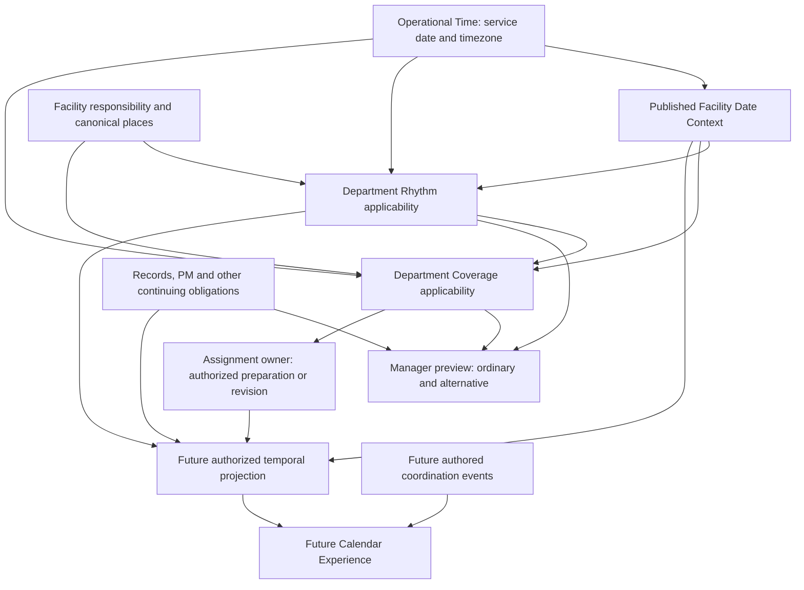
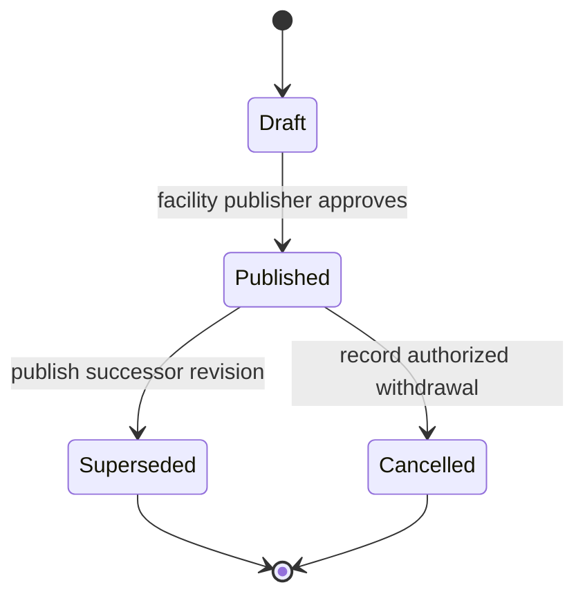

# CAL-01 · Calendar and temporal architecture contracts

**Submitted for product-owner review · November 25, 2026.** The accepted direction is Option C, shared Operational Date Context first. This document proposes a **Facility Date Context** as the smallest reusable addition. An installed Department would use its own published rules to explain how a named facility service date affects its Rhythm and Coverage. Option D, an integrated calendar, remains a possible later destination. [Accepted direction and pending decisions](DECISIONS.md) · [Source audit at `9f3388ac`](CAL-00_TEMPORAL_ARCHITECTURE_AUDIT.md)

The first proof is a **read-only comparison for one authorized manager, one facility, one installed Department and one service date**. It must identify what changes at each affected Unit or Space, why it changes, which obligations continue and which choices require review. Publication of a facility fact and approval of a Department response are separate acts. The comparison supplies evidence for a future decision to activate a response.

## Ownership and dependency direction

| Responsibility | Status | Source and boundary |
| --- | --- | --- |
| Operational Time | Implemented, with reader and historical gaps below | Supplies the facility civil date, IANA timezone and local-window conversion. Use the same date basis across owners. The Scheduled Evaluation clock may ask an owner to evaluate due work. Each domain keeps its own recurrence. [Operational Time](../../src/lib/operational-time/) · [01B Amendment G](../product/01B_PHASE_1_ARCHITECTURE_CONTRACTS_AMENDMENT_2026-11-08.md#amendment-g--temporal-foundation) |
| Facility Date Context | New primitive proposed under registry Rule 10 | One facility publishes a classification occurrence and its revisions. Its scope ends at the named service date and its meaning to that facility. See the proposal below. |
| Domain-owned applicability | Existing owners, proposed extension | Department Builder authors published Cycles and explicit Coverage needs. Each owner would resolve its own rules against published context. Assignment consumes the need and owns daily placement. Facility Builder supplies responsible places. [Department Builder](../product/16_DEPARTMENT_BUILDER_ARCHITECTURE.md) · [Cycle selection](../../src/lib/operational-cycles/load-published-cycles.ts#L105) · [Coverage matching](../../src/lib/scheduling/coverage-expectations/match-expectation.ts#L44) |
| Unified Temporal Projection | Approved architectural target in 01B | A bounded, permission-filtered read combines owner projections. Each item identifies its source, date or interval, status, audience, canonical reference and distinction between forecast and established fact. Source revision and identity support deduplication. [01B](../product/01B_PHASE_1_ARCHITECTURE_CONTRACTS_AMENDMENT_2026-11-08.md#amendment-g--temporal-foundation) |
| Calendar Experience | Deferred | A future Calendar may display projected items alongside separately authored coordination events. Edits follow the source's authority. Authored events, audiences, invitations, recurrence and synchronization need a later decision. Dashboards, Job Flow and Review retain their own purposes. [Original scenario and options analysis](CAL-00_TEMPORAL_ARCHITECTURE_AUDIT.md) |

The arrows show the direction in which facts flow. The ordinary selection path remains available without date classification. Preview reads both owners for the same authorized scope.

Arrows to Assignment and the future projection express ownership if those later phases are authorized. Preview terminates at the comparison. Build owns configuration, Run consumes established decisions and Audit / Reports reconstructs expected and actual facts from the owners. Amendment 01C retires generic Work and Department profiles. A named date creates neither a universal operating profile nor a source of Tasks. Existing domain recurrence, Scheduled Evaluation and Notifications retain their responsibilities. [01C](../product/01C_PRELAUNCH_CANONICAL_RESET_AMENDMENT_2026-11-10.md) · [Registry](../product/15_PLATFORM_PRIMITIVES_AND_ENGINES_REGISTRY.md)

## Registry proposal for Facility Date Context

| Required field | Proposed answer |
| --- | --- |
| Missing capability | Under the proposal, the current Facility Administrator could name one facility-local service date once, distinguish actual and observed occurrences, and publish an identifiable revision that several installed Departments may reference. |
| Why no existing owner fits the shared fact | Operational Time owns civil-time calculation. Rhythm and Coverage own Department configuration. Records, Menus, PM and Notifications each own a different domain fact. Publishing a facility holiday from one Department would make its authority extend to peer Departments. |
| Why composition is insufficient | From the same Thursday windows and staffing needs a reader cannot infer whether the facility observed a holiday, who published it or which revision a plan used. A projection of existing facts cannot supply that missing input. |
| Proposed source of truth | A facility-governed publication of a classification occurrence. An occurrence has a stable identity and addressable revisions. The separate Department response remains with its authoring domain. |
| Proposed lifecycle | Draft, publish, supersede or cancel while retaining previous published revisions. A late correction carries its recorded time and reason. Historical owners pin the revision they used. |
| Limits of responsibility | Date classification ends at the facility fact. Domain owners retain operational effects, recurring schedules, employee placement, Records, waivers, Assets, PM and operational history. |
| Interacting Platform Domains | A, Context & Configuration, supplies the facility context. B, Operating Rhythm & frontline composition, and C, People & Coverage, resolve local effects. H, Governance & Platform Services, governs publication and access. D, Records & Assurance, and E, Assets & Maintenance, supply independent obligations. |
| Eligible Department Products | Installed Food and Nutrition, Environmental Services and Facility Plant Operations may opt in locally. The Cafeteria blueprint demonstrates demand. It conveys no Product registration or release. |
| Eligible surfaces | Facility governance for publication, Department Builder Operating Rhythm and People & Coverage for local responses, a manager planning comparison and later authorized Run, Dashboard and Audit reads. Each surface consumes its owner's service. |
| Historical and migration implications | Existing dates have no inferred classification. Ordinary operations continue. Source owners preserve a published basis prospectively. Past records with insufficient provenance expose that limitation. Any future backfill needs explicit authority and evidence. |
| Identity and model reuse | Reference the installed Department, Facility responsibility, exact Unit or Space, role registry, published versions and existing evidence. Catalog, person, Team, place, Asset, Work Order and Record identity stay with their owners. |
| Product-owner architecture decision | Option C is accepted as direction. Approval of this primitive, its publication authority, the scope of domain extensions and all implementation is pending. [Decision register](DECISIONS.md) |

The proposal follows the [Rule 10 justification and proposal template](../product/15_PLATFORM_PRIMITIVES_AND_ENGINES_REGISTRY.md#template-for-proposing-a-new-engine). Rhythm and Coverage changes extend existing owners. Neither requires a new operational engine.

## Minimum data exchanged

These are facts a reader must be able to distinguish. Storage layout and API names remain open.

| Contract | Required meaning |
| --- | --- |
| Facility occurrence | Facility identity, stable classification identity and occurrence identity, human-readable label, one exact local service date, actual/observed designation when applicable, optional link between related occurrences, publication state and revision, actor, recorded instant and correction/cancellation reason. Date-only occurrences cover the facility civil day. A general timed interruption is outside the first release. |
| Rhythm or Coverage response | Facility and installed Department, governing operator period, owning module, classification reference, effective bounds using owner conventions, version and publication evidence, canonical target and existing stable requirement identities, ordinary baseline and proposed retained, replaced, added or removed requirements. Record the reason for removal and preserve the baseline. Refer to published source versions only. |
| Evaluation request | Acting principal and authorized scope, requested service-date key, governing zone and time basis, installed Department and relevant operator period, optional canonical locations, and whether comparison is prospective or for an established date. The server derives and validates authority and source identities. |
| Comparison | Baseline and alternative configuration identities/versions, occurrence and rule revisions, per-place Cycle/Phase/Key Point windows, Coverage role, required count and change, unaffected scope, independent obligations, conflicts, reasons and evidence references within the audience. Label forecast, established, unconfigured and unavailable results distinctly. |
| Established domain decision | The source retains the service date and governing timezone or effective zone reference, evaluation/publication instants, occurrence and rule revisions, selected configuration and place, operator period, accountable actor/action and successor or correction reference. Persist evidence at the owning domain’s establishment boundary. Preview needs no durable operational decision. |

The requested service date is a civil date in the facility timezone. Publication instants and occurrence dates answer different questions. Related actual and observed dates have separate identities. A holiday name, a UTC date, a Product key or a display label is insufficient as the sole lookup key. An ordinary forecast uses the published configuration effective on that date. Review of a prepared or executed day uses its established basis.

## Publication, authorization and lifecycle

**Facility publication.** Proposed for review, the current Facility Administrator may publish or cancel an occurrence for their own facility. A draft remains private to authorized authors. Publication validates scope, service date, identity, expected revision and authority at the time of action. Repeating the same request must produce the same result. A stale edit returns a conflict with a path to compare the current revision. A correction that moves the date preserves the earlier occurrence revision and its original date for readers that already relied on it.

**Department response.** The authorized owner uses the appropriate Rhythm or People & Coverage workflow within one installed Department and operator period. A reference to a classification may be authored independently of any particular occurrence. Its operational effect requires both a published occurrence and an applicable published response. A Product starter needs local adoption. The facility publisher cannot make this approval on behalf of a vendor or self-operated Department by virtue of being facility publisher. Future Department writes need the module permission, CDA management authority and a write-manifest classification. [CDA](../contracted-departments/ARCHITECTURE.md) · [Access](../../src/lib/department-authority/access.ts) · [Write manifest](../../src/lib/department-authority/write-manifest.ts)

**Read authority.** Resolve the requesting principal's present access, the facility and installation, source audience, permitted detail, place responsibility and the operator governing the date or established fact. Current access and historical operator identity are separate checks. A Department head, member or authorized management delegate receives only their permitted module and place scope. The Facility Administrator has governance and the allowed view of a self-operated Department. After vendor control is established, the facility receives permitted summaries and read-only compliance Records. Apply handover rules to transitional states. Team membership, a shared room and a Product filter confer no audience or write authority. Filter before composing counts, deltas, conflict messages and source links. Even a restricted title or empty-versus-nonempty count can reveal another operator’s data. A future shareable advisory requires its own approved audience. [Visibility](../../src/lib/department-authority/visibility.ts) · [Operator periods](../../src/lib/department-authority/operator-period.ts) · [Handover tests](../../src/lib/department-authority/cda06-handover.db.test.ts)

**Cancellation and change.** Cancelled or superseded revisions stay addressable. For an unprepared future operation, resolve the remaining valid occurrences and rules again. If none match, show ordinary operations and the reason. For a prepared board, established Key Point, submitted Record or emitted PM occurrence, show the proposed impact to an authorized viewer. An owner-authorized revision must preserve the original decision, actor, reason and affected scope. Completed facts, corrections and waivers follow their existing source lifecycle. An unavailable historical timezone or operator basis yields an explicit evidence gap.

The diagram is the lifecycle of one occurrence revision. A Department’s own draft, published rule, dated decision and revision have independent lifecycles. There is no facility-wide freeze or day-close assumed here.

## Resolving one comparison

1. **Establish the date and scope.** Validate the requested local date, load its governing timezone, current viewer authority, installed Department and operator for the date. Check the exact Unit or Space and its Department responsibility. A Department-wide Cycle may follow responsibility. Explicit Key Point room groups and Coverage locations keep their configured identities. Preserve the historical target when a room is reassigned. [Department Builder](../product/16_DEPARTMENT_BUILDER_ARCHITECTURE.md)
2. **Identify the ordinary result.** Use the existing effective versions, weekday and canonical place rules for Rhythm. Use the ordinary applicable Cycles for Coverage binding. Preserve multiple simultaneously valid requirements. Where configuration is optional and missing, report “unconfigured.” A published need with no qualifying placement is a separate finding. [Cycle reader](../../src/lib/operational-cycles/load-published-cycles.ts) · [Coverage publication](../../src/lib/scheduling/coverage-expectations/publication.ts)
3. **Determine whether the date matters.** Look up published occurrences for the exact facility and date. Pass the matched classification to each opted-in owner's applicability calculation. Resolve eligible published versions and explicit alternative conditions **before ordinary weekday filtering discards the candidates for the alternative path**. Keep effective bounds, publication, operator, location and authorization checks in both paths. Rules must explicitly designate any alternate weekday applicability. A broad classification alone cannot make an out-of-scope or expired version eligible.
4. **Compose compatible effects.** Rhythm determines the selected Cycle identities and windows. Coverage evaluates its stable Cycle bindings and exact location, role, interval and required count against that selection. An explicit rule names the baseline requirements it retains, replaces, removes or adds. Coexisting Phases, distinct slots and unbound Coverage needs remain valid. Match stable identities before comparing counts. The order in which classifications or rows are returned cannot pick a winner.
5. **Check continuity and conflicts.** Where overlapping rules disagree about the same obligation, location and operating interval, disclose the conflict within the viewer’s audience. Block activation for the affected scope until the owning Department publishes an authorized explicit resolution. The owning services must check all affected obligations, including those the viewer cannot see. Return only audience-safe outcomes. An incomplete owner check blocks activation. When a required Record would lose its bound PERIOD Cycle, Records must resolve the dependency. Independently required Key Points remain under Rhythm. An unauthorized viewer cannot inspect another Department’s dependency or bypass its owner’s check. Record evidence, waivers and PM closeout retain their meanings. [Record requirement resolution](../../src/lib/canonical-logs/resolve-log-requirements.ts#L276) · [Expected Record history](../../src/lib/canonical-logs/expectation-history.ts#L199) · [Work Order closeout](../../src/lib/asset-operations/work-order-closeout.ts#L901)
6. **Return an explainable result.** Show the ordinary and alternative selection, the governing date and timezone, per-owner revisions and location-level changes, continuing obligations and restricted or unresolved portions where disclosure is allowed. For established facts, display the governing decision beside the proposed change. Reads must cause zero changes to plans, assignments, Key Point expectations, evidence, PM, events and offline catalogs or receipts. Two reads with the same versions, date, authority and scope yield the same result.
7. **Reserve operational action to the owner.** A future, separately authorized write would recheck scope, current write authority, source versions and plan state, then atomically establish or revise the owner decision and record provenance. A stale preview cannot authorize a write. Retrying an approved action must not duplicate slots or placements. Employee qualification, shifts, call-offs, exceptions, overlap and supervisor review stay with workforce owners. [Assignment application](../../src/lib/scheduling/operational-assignments/apply-assignment-template.ts) · [Plan visibility](../../src/lib/scheduling/operational-assignments/assignment-plan.ts#L101)

### Result and failure states

| Reader outcome | Meaning and permitted consequence |
| --- | --- |
| Ordinary | Successful, authorized resolution found no matching published occurrence or no applicable published alternative. Show the ordinary configuration and reason. |
| Alternative | Both sources resolve. Show selected and ordinary versions, scope and reasons. An independently authorized activation would be a separate step. |
| Unconfigured | Optional baseline or referenced dependency is missing. Identify the missing setup where authorized. Keep an absent alternative distinct from an authored rule pointing to missing configuration. The latter requires review. |
| Conflict or stale revision | Contradictory effects, a protected obligation lost, an outdated revision or an unsuitable window prevents a determinate operational change. Preserve existing facts and present the affected owner with a way to resolve it. |
| Established | An owner has already prepared or recorded the obligation. Show its original basis and separately identify a prospective difference or subsequent authorized revision. |
| Unavailable or insufficient historical basis | A required owner, date basis, revision or operator period cannot be resolved. Mark the comparison incomplete. Operational activation is blocked in that scope. |
| Unauthorized | Deny or omit the source according to existing audience rules. Produce the same audience-safe response irrespective of the content of a hidden source. Block any dependent change that cannot be safely validated by its owner. |

**Smallest acceptance example (synthetic).** A facility publishes an observed holiday for a Thursday. One installed Department has adopted an alternative for a retail Space. In the ordinary selection that Space has a 10:00–14:00 Cycle and requires two staff. Its proposed alternative selects a published 11:00–13:00 window and requires one staff member. A second, resident-service Unit keeps its ordinary Cycle and Coverage. The preview names both version pairs and the actual hours, shows the one-person reduction, and explains the unchanged resident service and independent cooler inspection. If the shorter Cycle would eliminate the inspection slot, the result becomes “conflict” and identifies the Records dependency to an authorized reviewer. A second installed Department with no response sees its own ordinary answer. Opening either preview leaves every operational source as it was.

## Temporal reconciliation inventory

Severity estimates the consequence if a Calendar decision relies on the present path. **Critical** covers loss of independent obligations, disclosure across operators or corruption of established facts. **High** covers materially different operational answers across supported consumers. Tests listed here are proposed regression cases. CAL-00 separately records the subset of existing tests it actually ran.

### TEMP-01 · Requested service date across planning and runtime — High

**Owner and consumers.** Operational Time owns the local-date primitives. Staffing and Runtime Location State own correct date propagation at their respective entry points. The staffing board can initialize from server-local time. Runtime prefetch accepts an explicit date, but a downstream Run model uses an instant. Coverage summary also has an incomplete timezone path. Planning, Dashboard, Job Flow and Review can therefore disagree about which published Cycles apply. [Board](../../src/app/%28protected%29/staffing/assignments/page.tsx#L45) · [Prefetch](../../src/lib/runtime-location-state/prefetch.ts#L98) · [Run model call](../../src/lib/runtime-location-state/prefetch.ts#L203) · [Summary](../../src/lib/scheduling/operational-assignments/build-coverage-summary.ts#L165)

**Reuse, remediation and dependencies.** Thread the validated requested date and facility zone to the existing date-explicit Cycle, Coverage and Records readers. Retain the instant for genuinely current-state questions. Distinguish a historical or future date from a live “now” view. Establish this shared input before TEMP-02/03 parity and before presenting a forecast.

**Regression evidence required.** With a fixed instant that is Sunday locally and Monday in UTC, request a future Monday and compare the board, preview and date-addressable readers against Monday's published selection. A live Sunday must still show Sunday. Run with a different server timezone. [Operational Time tests](../../src/lib/operational-time/operational-time.test.ts) · [Runtime tests](../../src/lib/runtime-location-state/runtime-location-state.hermetic.test.ts)

### TEMP-02 · Coverage calculation, Assignment preview and application — High

**Owner and consumers.** People & Coverage owns effective needs. Assignment owns suggestions, selection and application. Effective template selection alone does not establish that a Cycle-bound item applies to the requested place and date. Summary matches publication and Cycle bindings. The template preview iterates its items, while apply rechecks item/template validity on its own path. [Coverage matcher](../../src/lib/scheduling/coverage-expectations/match-expectation.ts#L44) · [Template preview](../../src/lib/scheduling/operational-assignments/load-assignment-template-preview.ts#L87) · [Apply](../../src/lib/scheduling/operational-assignments/apply-assignment-template.ts#L30)

**Reuse, remediation and dependencies.** Reuse the same versioned needs, canonical places, stable Cycle matching and qualified Assignment rules for each consumer. Return an identical set of applicable slot identities/counts for the same inputs. Re-evaluate them at write time under the owner's transaction and existing employee-day overlap protection. Depends on TEMP-01 and TEMP-03 for time-window cases.

**Regression evidence required.** Use two locations, one unbound opening and weekday-only Cycle-bound needs. Check ordinary, alternative and absent-Cycle cases, counts greater than one, and a valid simultaneous need. Preview and summary must agree. A rule superseded between preview and apply must require review and leave no partial placement. A repeated valid application cannot duplicate a placement. [Assignment lifecycle tests](../../src/lib/scheduling/operational-assignments/assignment-lifecycle.db.test.ts)

### TEMP-03 · Overnight windows, DST and date line — High

**Owner and consumers.** Operational Time converts civil times. Rhythm owns Cycle windows, and Assignment owns responsibility windows including overnight on-call. Cycle windows use an explicit civil day. Assignment application constructs both endpoints from one service date through a different conversion. Coverage, on-call routing, Job Flow and a future preview depend on agreement about the resulting instants. [Civil-date conversion](../../src/lib/operational-time/build-operational-time-context.ts#L24) · [Cycle windows](../../src/lib/operational-cycles/cycle-windows.ts) · [Assignment endpoints](../../src/lib/scheduling/operational-assignments/apply-assignment-template.ts#L54) · [On-call resolution](../../src/lib/scheduling/operational-assignments/resolve-operational-response.ts)

**Reuse, remediation and dependencies.** After TEMP-01, standardize the contract around explicit starting service date, IANA timezone and resolved start/end instants. Advance the civil end date for a declared overnight window. Proposed ordinary window ownership follows the starting date. A timed shutdown, if separately authorized, intersects the actual interval and can affect two displays. Treat exact boundaries as half-open intervals. Obtain owner policy for nonexistent, repeated or ambiguous equal local endpoints before accepting an ambiguous publication.

**Regression evidence required.** Check a 22:00–06:00 window on either side of a holiday, a handoff exactly at 06:00, Pacific/Kiritimati across the UTC date line, and America/New_York spring gap/fall fold. Pin expected UTC instants, elapsed durations and owning service date. Exercise both Cycle and Assignment lookup, including an on-call inquiry after midnight. [Existing DST examples](../../src/lib/operational-cycles/cycle-windows.hermetic.test.ts#L63)

### TEMP-04 · Historical timezone provenance — High

**Owner and consumers.** Facility owns its timezone. Each owner that establishes a dated expectation owns its recorded time basis. Day and range Review can use current facility settings for an earlier date. Audit, exports and offline reconciliation need to know which civil-day boundary and window applied at establishment. [Day loader](../../src/lib/operational-review/load-operational-review-day-facts.ts#L54) · [Range loader](../../src/lib/operational-review/load-operational-review-range-facts.ts#L67)

**Reuse, remediation and dependencies.** Use Operational Time and retain an effective timezone reference or the historical timezone with the owner decision. Retain resolved instants when a wall time alone cannot reconstruct the governing window. Honor preserved source snapshots. Expose unavailable historical basis where evidence is insufficient. Depends on TEMP-01/03 and owner agreement on establishment.

**Regression evidence required.** Change the configured timezone after a board and expected slot were established near midnight. Day/range Review and any export must retain their original date and instants. A new forecast uses its proper effective basis. Test a legacy row with inadequate evidence as unavailable. Required before historical comparison or activation that creates reliance.

### TEMP-05 · Historical operator-period selection — Critical

**Owner and consumers.** Contracted Department Authority (CDA) owns access and period filtering. Rhythm and Records supply dated configuration, and Review and projections compose it. A current-period default or one period filter reused across a range spanning handover can select the wrong operator's configuration. [Dated period selection and operating filter](../../src/lib/department-authority/operator-period.ts#L16) · [Default evaluation instant](../../src/lib/department-authority/operator-period.ts#L82) · [Records Cycle loader](../../src/lib/canonical-logs/load-published-cycles-for-logs.ts#L62)

**Reuse, remediation and dependencies.** Evaluate present viewer rights separately from the operator who governed the date or established the row. Partition date ranges at handover and preserve the row’s period where available. Apply CDA audience, summary and compliance-only rules before comparison or aggregation. Depends on TEMP-01 and a sound date/zone basis. Period ambiguity blocks the affected scope, including a read-only preview.

**Regression evidence required.** Self-operated, vendor A and vendor B periods across the same room. Test both directions of handover, one-day and range queries, lost current access, the facility’s permitted summary and permitted read-only compliance detail. The former operator cannot infer the successor's counts, title or source links. [Operator period tests](../../src/lib/department-authority/operator-period.hermetic.test.ts) · [Authority tests](../../src/lib/department-authority/department-authority.db.test.ts)

### TEMP-06 · Multi-Department Coverage Review — High, with an authority dependency

**Owner and consumers.** Audit / Reports composes day and range facts from Coverage, Rhythm and Assignment. The current day composer selects templates from a shared input and can choose the first Department’s plan for locations shared across Departments. Shared Cycle stable keys can collide across Departments. Review and any future multi-Department preview or aggregate can misattribute results. [Template and Cycle composition](../../src/lib/operational-review/compose-operational-review-day.ts#L216) · [First Department and plan](../../src/lib/operational-review/compose-operational-review-day.ts#L247)

**Reuse, remediation and dependencies.** Partition by authorized installed Department and operator before selecting templates, Cycles, locations, assignments and plan state. Invoke the existing Coverage evaluation for each partition. Compose audience-safe results afterward. Depends on TEMP-01/02/05. A one-Department preview can proceed only with its enforced single scope. Multi-Department Review or a combined comparison requires this reconciliation.

**Regression evidence required.** Two Departments share a room, role or Cycle key and have different plan states. The combined result in both input orders must equal the authorized union of the independent results. Reject double counting and hidden-Department totals. Cover day, range and permission-limited results. [Review composition tests](../../src/lib/operational-review/compose-operational-review-day.hermetic.test.ts)

### TEMP-07 · Offline baseline and historical materialization — Critical

**Owner and consumers.** Offline owns issuance, replay validation and receipts. Rhythm owns dated Key Point expectations. The Space offline path can rebuild a catalog during replay before deciding whether an action is stale. The preparation option can create missing rows. Historical Review and Job Flow depend on the original established baseline. [Space service](../../src/lib/offline/space/service.ts#L120) · [Replay check](../../src/lib/offline/space/service.ts#L215) · [Materialization](../../src/lib/operational-cycles/materialize-key-time-day-expectations.ts#L164)

**Reuse, remediation and dependencies.** Separate pure historical resolution from authorized current-day preparation in the owning paths. Validate the issued baseline, exact place, date, decision revisions and current rights before permitted effects. Preserve the source’s idempotent receipt semantics. An obsolete, revoked or closed action cannot create a missing past expectation as a side effect of checking it. Depends on establishment policy and TEMP-01/03/04/05. Preview requires a verified pure path. Operational activation touching offline consumers requires replay proof.

**Regression evidence required.** Issue a baseline, change the occurrence or board and advance the clock a day. Replay against a missing past Key Point. Assert a stale/denied outcome according to current access, no historical row or completed work, and no duplicate receipt on retry. Test an unchanged valid baseline, revoked membership and reopened-plan visibility. [Offline database tests](../../src/lib/offline/space/space.db.test.ts) · [Plan visibility](../../src/lib/scheduling/operational-assignments/assignment-plan.ts#L101)

## Evidence required at each gate

| Gate | Conditions for a pass | Example evidence |
| --- | --- | --- |
| Read-only preview (CAL-04) | TEMP-01/02 agree for the supported inputs. TEMP-03 is proved for every offered window or the comparison explicitly reports unsupported. Prove current access and date-correct operator scope (TEMP-05). Require TEMP-04 for historical comparisons. Enforce single-Department isolation until TEMP-06 passes. Demonstrate a side-effect-free read path independently of any offline or current-day preparation (TEMP-07). | One ordinary Thursday, one named Thursday with a valid response, and a Department with no response. Compare by location, Cycle, Coverage count, version and reason. Add an expired target, incompatible classifications and an orphaned inspection. Repeat with an obligation in a restricted Department. Verify that the owner blocks unsafe activation and the viewer cannot infer its details. Compare operational rows before and after repeated previews, including when dependencies fail and requests are denied. |
| Controlled operational activation (CAL-05) | Resolve TEMP-01–05 for every participating writer and reader. Resolve TEMP-07 for every affected offline path and TEMP-06 for any affected combined read. Approve authorization, conflict handling and each owner’s establishment/revision boundary. An unsupported downstream read bars activation of operations it would misrepresent. | Prepare, confirm, reopen and close a board. Revise or cancel a classification between preview and action, including concurrent requests. Verify atomic revalidation, no duplicate placement, explicit revision history, independent Records and PM continuity, and agreement across participating Run, Review and offline consumers. |
| Integrated certification (CAL-08) | Reconcile all seven findings across supported owners and surfaces. Produce dated evidence for the ten CAL-00 scenarios, with an explicit boundary and expected result for deferred capabilities. Prove end-to-end visibility, historical integrity, retries and date boundaries on the identified commit. | Day and range Review, shared-room differing Departments, vendor handover, changed timezone and room responsibility, late offline replay, protected Record/PM closeout, observed holiday, exceptional closure and projection deduplication. Distinguish executed database/browser checks from source inspection. [Ten discovery scenarios](CAL-00_TEMPORAL_ARCHITECTURE_AUDIT.md#6-all-ten-scenarios) |

### Historical integrity and independent obligations

- **Establishment follows the owner.** A board with persisted entries is prepared even while its plan is draft. Confirmed and reopened boards can be visible to frontline staff. Existing Key Point expectations and actuals, submitted Records and emitted maintenance occurrences have their own establishment points. An unprepared forecast may resolve again. Review distinguishes the original plan, authorized revisions and actual events. [Assignment plan](../../src/lib/scheduling/operational-assignments/assignment-plan.ts) · [Dated Key Point materialization](../../src/lib/operational-cycles/materialize-key-time-day-expectations.ts) · [PM generator](../../src/lib/preventive-maintenance/generator.ts)
- **Revision preserves the decision already relied on.** If a holiday moves from Friday to Monday after Friday’s board was confirmed, Friday retains its governing revision. The Department can review a dated difference and approve any supported prospective revision. A revised group of rooms does not retroactively change the original places. An issued offline baseline uses its established revision subject to current access. Closed or completed facts use owner corrections, with the original identifiable.
- **Protected obligations survive a configuration change.** Records can derive a setup gap when a timing anchor disappears, and historical expectation reads can omit that state. The preview must detect a proposed orphan even if a downstream historical view would omit it. A Records-authorized rebind or a separately authorized exception may resolve it. Waivers, submitted evidence, PM occurrences and Work Order closeout remain distinct. Changing only the hours can also change the Record requirement key for the same Cycle. Exercise a submitted slot and a separately waived slot. Preserve each original key and its evidence or waiver, avoid duplicate or spuriously missing obligations, and identify a reviewed successor for any prospective slot. Test the resulting visibility in Run, Review and permitted exports. [Requirement key inputs](../../src/lib/canonical-logs/resolve-log-requirements.ts#L307) · [Waiver scope](../../src/lib/audit/create-waiver.ts#L50) [Record derivation](../../src/lib/canonical-logs/resolve-log-requirements.ts#L276) · [History filtering](../../src/lib/canonical-logs/expectation-history.ts#L199) · [Closeout tests](../../src/lib/asset-operations/work-order-closeout.hermetic.test.ts)
- **Later projection and Calendar gates.** A Plant shutdown crossing midnight can appear on both local dates with one source identity. Multiple authorized lenses must not double count a PM occurrence, shift or inspection. A private Plant event may have a separately approved audience-safe advisory. Any Department response still requires its own authorization. Ordinary meetings or training carry no operational influence by default. General event recurrence, sync and automatic cross-Department impact remain deferred.

## Review disposition

**Recommended with prerequisites.** Approve or amend CAL-D01–11 before operational influence. The principal open questions are who can publish and revise, how actual/observed dates and overnight windows are distinguished, which requirements a response can replace, who resolves conflicts and endangered independent obligations, when each domain freezes its original basis, and which details may cross an operator boundary. [Decision register](DECISIONS.md)

The next scope proposed for separate authorization is **CAL-02 temporal reconciliation**, starting with reproducible TEMP-01–03 comparisons on existing date, Cycle, Coverage and Assignment readers. Record the named owners, supported inputs, regression evidence and remaining preview/activation gates for TEMP-04–07. Product-owner approval of a specific scope is the entry condition. [Phase tracker](PHASE_TRACKER.md)
