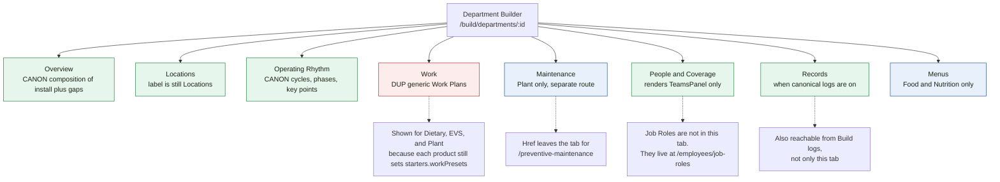

# Visual 1 — Current Department Builder architecture

Source: `src/lib/department-administration/admin-nav.ts`, the department page at `src/app/(protected)/admin/departments/[departmentId]/page.tsx`, and the Prisma models those sections read. This is the live shape, including overlap.

## Shell today

`departmentAdminTabsForFlags` builds this bar. Retired `?tab=` values (`room-types`, `areas`, `archetypes`, `rooms`, `cycles`, `teams`, `coverage`, `diagnostics`, `versions`, `settings`) redirect into a surviving tab. They are not sections.



**Repo vs November 1.** The target shell is Overview / Facility / Operating Rhythm / People & Coverage / Records, plus Menus or Preventive Maintenance. The running shell still says Locations, still includes Work, and labels Plant’s extension Maintenance.

## What sits under each section

```text
Department Builder
│
├── Overview
│     installed product, configuration gaps, location coverage summary
│     READ of other sections. No separate readiness store.
│
├── Locations                                          ← see the tangle below
│     Facility tree filtered to this Department's responsibility
│     Location Function bind + publish on the working profile
│     room inspect = Location Program (teams, cycles, logs, assets)
│     "rooms of this Facility type not on a team yet"
│
├── Operating Rhythm                                   CANON timing
│     DepartmentOperationalCycle
│       PERIOD  = Cycle or Phase
│       KEY_TIME = Key Point, with room groups
│     location modes still stored:
│       ALL_DEPARTMENT_UNITS | EXPLICIT_UNITS
│       (OPERATIONAL_TYPES / UNIT_TYPES / ROOM_TYPE no longer match)
│       UNIT_TYPES and ROOM_TYPE remain as legacy modes
│
├── Work                                               DUP — scheduled for retirement
│     DepartmentWorkPlan + items
│     applicability: unit, space, space type, asset, asset type,
│                    or DepartmentRoomArchetype.key
│     DepartmentWorkOccurrence
│     product work presets
│
├── Maintenance                                        Plant extension, mis-named
│     PreventiveMaintenancePlan on an Asset
│     versions, record requirements, occurrences
│     NOT generic Work, but the product still also has work presets
│
├── People & Coverage                                  the tab is Teams
│     DepartmentTeam
│       employees, manager, rooms, operational-type keys,
│       cycle link, required count, TOTAL or PER_ROOM grain
│     Coverage expectations are a different store and are not this panel
│     Department Job Roles are a different screen
│
├── Records                                            CANON engine, several aimers
│     CatalogLogDefinition → FacilityCatalogInstall → LogAttachment
│     LogAttachment may target asset, space, unit, department,
│     facility, or an operational-type key
│     PLUS DepartmentFacilityTypeLogDefault on physical FacilityRoomType
│     PLUS DepartmentLocationLogSuppression per room
│
└── Menus                                              Food and Nutrition extension
      Menu identity in Menu Builder
      MenuLocationApplicability on Unit XOR UnitSpace
      MenuOperationalCycleApplicability on cycle stableKey
      this tab displays; it does not own a second menu engine
```

## Locations: one room, many attachments

There is still one physical `UnitSpace`. The mess is the number of Department concepts aimed at it.

```mermaid
flowchart TB
  US["UnitSpace<br/>one physical room<br/>CANON identity"]

  subgraph phys ["Facility Builder — CANON physical tree"]
    FAC["Facility"]
    BLD["Unit hierarchyRole BUILDING"]
    FLR["Unit hierarchyRole FLOOR<br/>structural, not a Department location"]
    NBH["Unit hierarchyRole NEIGHBORHOOD<br/>LEGACY_LOCATION still classifies as neighborhood"]
    STG["Unit hierarchyRole STAGED<br/>undesignated, excluded from Department locations"]
    FRT["FacilityRoomType<br/>CANON physical type"]
    SPT["SpaceType plus customTypeLabel<br/>LEGACY physical classification"]
    UDR["UnitDepartmentResponsibility<br/>CANON neighborhood responsibility<br/>kind PRIMARY / BACKUP / SUPPORT"]
    USR["UnitSpaceResponsibility<br/>CANON room responsibility<br/>no kind — row means responsible"]
  end

  FAC --> BLD --> FLR --> NBH --> US
  FLR --> US
  NBH --> UDR
  US --> USR
  US --> FRT
  US --> SPT

  subgraph fn ["Department meaning — one mechanism, three vocabularies"]
    CAT["Product catalog location-functions.ts<br/>CANON keys: food_service_area,<br/>resident_care, service_support<br/>Plant: none"]
    PROF["DepartmentOperationalProfile<br/>DRAFT → CERTIFIED → ACTIVE → RETIRED"]
    ARCH["DepartmentRoomArchetype<br/>DUP name for the same key<br/>UI often says Location Function<br/>code often says Operational Type or pattern"]
    BIND["DepartmentRoomArchetypeBinding<br/>one archetype per profile per room"]
    AREA["DepartmentOperationalArea<br/>LEGACY"]
    AEXP["DepartmentAreaExperience<br/>LEGACY experienceKey"]
    AEX["DepartmentArchetypeExperience<br/>LEGACY"]
    RX["DepartmentRoomExperienceException<br/>LEGACY"]
    ECAT["src/lib/experiences catalog<br/>LEGACY Experience and Operational Area tree<br/>MEAL_SERVICE, TEMPERATURE_MONITORING, …"]
  end

  CAT -.-> ARCH
  PROF --> ARCH --> BIND --> US
  PROF --> AREA --> AEXP --> AEX --> ARCH
  PROF --> RX --> US
  ECAT -.-> AEXP

  subgraph reads ["Two composed views of the same room"]
    LP["location-program.ts<br/>READ current Director inspect<br/>teams, cycles, logs, assets<br/>does not carry Location Function"]
    ELP["effective-location-program.ts<br/>LEGACY READ<br/>header says keep until Run<br/>stops keying off archetype bindings<br/>still emits Experiences and Work overlays"]
    RLS["Runtime Location State<br/>READ<br/>Location Program plus an<br/>operationalType sidecar"]
  end

  US --> LP
  BIND --> RLS
  LP --> RLS
  BIND --> ELP
  AREA --> ELP

  subgraph also ["Other owners that also point at this UnitSpace"]
    TEAM["DepartmentTeamRoomMembership<br/>DUP location programming via Team"]
    TOT["DepartmentTeam.applicableOperationalTypeKeys<br/>DUP second use of the archetype key"]
    CYC["Cycle applicability<br/>explicit room OR operational-type keys<br/>legacy unit type and room type still stored"]
    KP["Key Point room group<br/>DepartmentOperationalCycleKeyTimeGroupRoom"]
    ZONE["DepartmentOperationalZone<br/>DUP saved room group<br/>not a Builder section"]
    LOG["LogAttachment<br/>space or operationalTypeKey"]
    TLOG["Facility-type log default<br/>DUP aim by physical type, then suppress"]
    MENU["MenuLocationApplicability"]
    ASSET["Asset.spaceId"]
    WORK["DepartmentWorkPlanApplicability<br/>DUP specific space, space type, or operational type"]
    COV["OperationalAssignmentTemplateItem<br/>coverage need by roleKey plus archetype key"]
  end

  US --> TEAM
  ARCH --> TOT
  US --> CYC
  ARCH --> CYC
  US --> KP
  US --> ZONE
  US --> LOG
  ARCH --> LOG
  FRT --> TLOG
  US --> TLOG
  US --> MENU
  US --> ASSET
  US --> WORK
  ARCH --> WORK
  ARCH --> COV

  classDef canon fill:#e7f6ec,stroke:#1f7a3a,color:#1a2114
  classDef read fill:#e8f1fb,stroke:#1d4e89,color:#1a2114
  classDef legacy fill:#f4f1ea,stroke:#8a6a2f,color:#1a2114
  classDef dup fill:#fdecec,stroke:#9b2c2c,color:#1a2114
  class US,FAC,BLD,FLR,NBH,FRT,UDR,USR,CAT canon
  class LP,RLS read
  class STG,SPT,AREA,AEXP,AEX,RX,ECAT,ELP legacy
  class ARCH,BIND,TEAM,TOT,ZONE,TLOG,WORK,COV dup
```



`BIND` is the current persistence of the key other engines expand. November 1 said to rename that key to Location Function. November 2 retires the key. See [08](./08_LOCATION_FUNCTION_ELIMINATION_AUDIT.md). Do not add a `LocationFunction` table.

## The same idea under several names

| Manager might mean | What the code calls it | Where it is stored |
|---|---|---|
| What this room is for this Department | Location Function, Operational Type, archetype, pattern | `DepartmentRoomArchetype.key` on a profile, via `DepartmentRoomArchetypeBinding` |
| Which Department owns the room | Responsibility | `UnitSpaceResponsibility`, separate from neighborhood `UnitDepartmentResponsibility` |
| What kind of room it is physically | Facility Room Type, and also legacy `SpaceType` | `FacilityRoomType`, plus `UnitSpace.spaceType` |
| Which people work here | Team room membership, and also daily Assignment | `DepartmentTeamRoomMembership` and `OperationalAssignment` |
| How many people are needed | Team cycle need, and also coverage expectation | `DepartmentTeamCycle.requiredCount` and `OperationalAssignmentTemplateItem.requiredCount` |
| Which Records apply | Attachment, or type default minus suppression | `LogAttachment` and `DepartmentFacilityTypeLogDefault` |
| A group of rooms | Neighborhood, Zone, team rooms, Key Point room group, explicit cycle locations | five different groupings |

## Profile perspectives already in code

These are current readers, not a proposal.

```text
working Build     DRAFT, else ACTIVE, else CERTIFIED
                  load-operational-type-targets.ts

Run               ACTIVE only. Draft never leaks in.

Audit / Review    the one profile whose activatedAt / retiredAt
                  window covers the service date
                  historical-operational-type.ts
                  today's ACTIVE is not a fallback
                  zero or two covering profiles = unavailable
```

`CERTIFIED` is a real status between draft and active. Activation is immediate. There is no scheduled future activation in the operational-type loader.

## Experience generation is still loadable

`resolve-room-profile.ts` still resolves:

```text
profile Experiences
    → archetype narrowing
    → sparse room exceptions
```

`effective-location-program.ts` still returns Operational Areas and Experiences, and its overlay list still includes cycles, teams, log attachments, assets, **work plans**, and coverage expectations. The Locations panel the director sees composes `location-program.ts` instead. Both resolvers exist.

The Experience catalog in `src/lib/experiences` still names areas such as Dietary Service, Food Safety, and Production, and experiences such as `MEAL_SERVICE` and `TEMPERATURE_MONITORING`. Department Builder no longer has Areas or Archetypes tabs. The old `room-types` department panel file is still in the tree and is not mounted by the current page.
