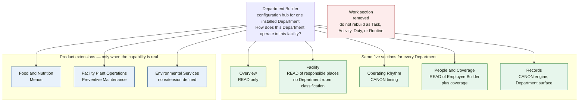
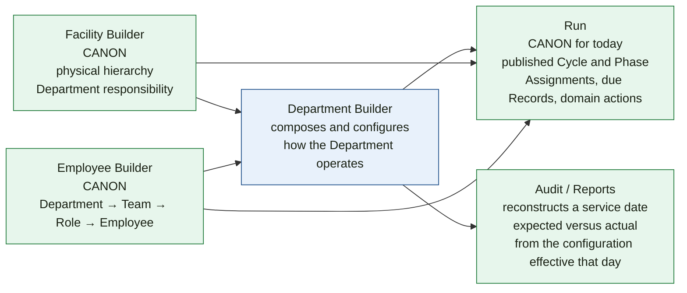

# Visual 2 — Proposed Department Builder architecture

Source: November 1, 2026 decision in [16 — Department Builder Architecture](https://github.com/ADTrauts/LTC-Manager/blob/architecture/department-builder-facility-reconciliation/docs/product/16_DEPARTMENT_BUILDER_ARCHITECTURE.md) and the Facility audit on the same branch. This is the target. It is not what the tab bar does today.

## Core shell and product extensions



```text
Department Builder
├── Overview
├── Facility                  ← today's Locations
├── Operating Rhythm
├── People & Coverage
└── Records

Food & Nutrition
└── Menus

Facility Plant Operations
└── Preventive Maintenance    ← today's Maintenance route

Work                        removed
```

**Repo vs November 1.** Today’s bar still inserts Work, still says Locations, and says Maintenance. All three products still declare `workPresets: true`, which is why Work appears.

## Ownership boundaries

Department Builder may show a fact. Showing it does not make Department Builder the author.



| Owner | Question it answers | Department Builder may |
|---|---|---|
| Facility Builder | What places exist, and which Departments are responsible? | Show them. Link edits of name, tree, and responsibility back here. |
| Employee Builder | Who works here, in which Team and Role? | Show them. Not author Team or Role identity. |
| Department Builder | How does this Department use those places, people, timing, and Records? | Compose them. Author only the Department configuration that has no other owner. Location participation is stored by Operating Rhythm, Records, Coverage, and Menus as canonical place ids. |
| Operating Rhythm | When does this Department run? | Show participation. Not create a second clock. |
| Records | What must be documented? | Configure Department requirements through the one engine. |
| Run | What is happening today? | Not store today’s truth on the builder. |
| Audit / Reports | What was expected, and what happened? | Not snapshot a private copy of every owner. |

Rule from the decision: **display can compose; editing follows ownership.**

## What Facility is in the target

```text
Facility Builder
    Facility
      Building          structural
      Floor             structural
      Neighborhood      actionable unit
      UnitSpace         the room
    UnitDepartmentResponsibility
    UnitSpaceResponsibility

Department Builder → Facility
    reads responsible places for the selected Department
    shows rhythm, people, coverage, records, assets, menus
    persists no second room, no room classification, and no merged copy
```

Forbidden by the decision, and already forbidden by the current foundation:

```text
DietaryLocation
EVSLocation
PlantLocation
DepartmentLocation
a second responsibility table
a new LocationFunction table beside the archetype store
  without an explicit migration
```

## Generic Work leaves the shell

The decision retires the Department Builder Work section and, after a dependency trace, the generic machinery: Work Plans, Expected Work, Work occurrences, Work presets, and Work-only applicability.

It does not retire Records, Operating Rhythm, shifts, Assignments, Coverage, Menus, Assets, or Plant Requests, Issues, Work Orders, and Preventive Maintenance.

**Repo vs November 1.** `DepartmentWorkPlan`, `DepartmentWorkItem`, `DepartmentWorkPlanApplicability`, and `DepartmentWorkOccurrence` are still in the schema. Job Flow and the Work tab still read them. Retirement is a decision, not a deletion.
