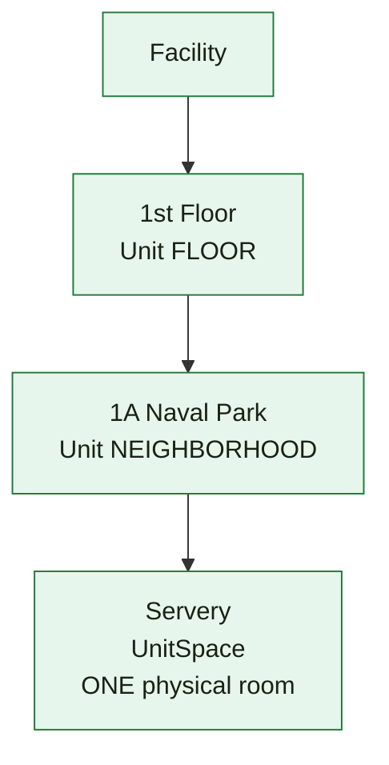
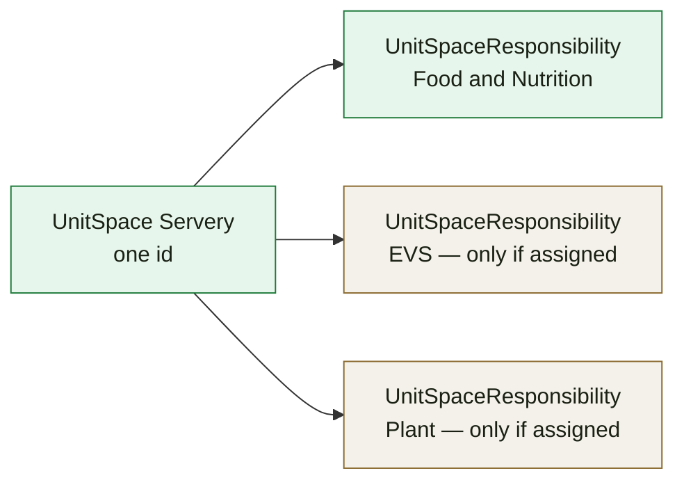
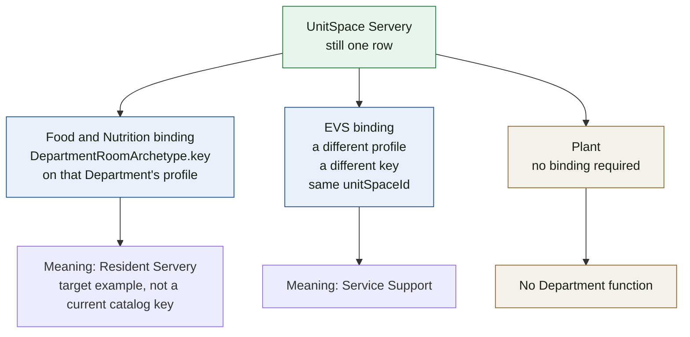
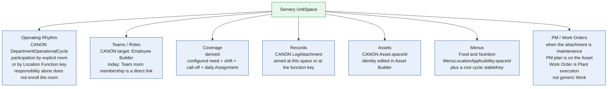

# Visual 3 — Facility / location ownership map

November 2, 2026: Department meaning is responsibility plus each engine’s own location ids. The Location Function examples below are the November 1 idea, now retired. See [08](./08_LOCATION_FUNCTION_ELIMINATION_AUDIT.md).

The point of this drawing: **there is one physical room.** Food & Nutrition, EVS, and Plant do not each get a copy of it.

The place names and function labels below are the November 1 example. They are not rows from a facility, and they are not the current Food & Nutrition catalog. Today that catalog has one function, `food_service_area` (“Food Service Area”). EVS has `resident_care` and `service_support`. Plant defines none.

## One walk down the physical tree

```text
Facility                          CANON  Facility Builder
  ↓
1st Floor                         CANON  Unit, hierarchyRole FLOOR
  ↓                               structural organizer, not a Department location
1A Naval Park                     CANON  Unit, hierarchyRole NEIGHBORHOOD
  ↓
Servery                           CANON  UnitSpace
                                  one id, one name, one parent
```



Floors are not assigned as operating locations. Neighborhood responsibility and room responsibility are separate rows. A room does not inherit responsibility from the floor or the neighborhood.

## Physical identity stays in Facility Builder

```text
PHYSICAL IDENTITY
Facility Builder
    owns the Servery UnitSpace
    owns its name, hierarchy, and FacilityRoomType
    Department Builder does not rename it and does not copy it
```

## Department responsibility is also Facility Builder

Responsibility is a relationship on the existing place. It is not a new place.

```text
DEPARTMENT RESPONSIBILITY
Facility Builder
    UnitSpaceResponsibility on Servery

    Food & Nutrition   = responsible     row exists
    EVS                = maybe           only if a second row exists
    Plant              = maybe           only if a second row exists
```

**Repo vs November 1 example.** Neighborhood rows have `kind`: PRIMARY, BACKUP, or SUPPORT. Room rows do not. A room is responsible or not, plus an optional `capabilities` string array. The example word “Primary” matches neighborhood responsibility, not the current room row.

Several Departments can hold a responsibility row on the same `UnitSpace`. That is still one room.



## Department meaning is not another room

Each responsible Department may bind its own Location Function to that same id. The binding is Department-scoped. It does not create a Dietary room, an EVS room, or a Plant room.

```text
DEPARTMENT MEANING
same UnitSpace id

Food & Nutrition
    Location Function = Resident Servery          target example
    current catalog key would be food_service_area

EVS
    Location Function = Service Support           current key service_support
    or Resident Care, if that is the function they bind

Plant
    possibly no Location Function
    the product list is empty, and empty is allowed
```



What we do not create:

```text
DietaryLocation
EVSLocation
PlantLocation
a Department room hierarchy
a second UnitSpace per Department
```

## What else may attach to that same room

Each line has its own owner. The Facility page can list them. It does not absorb them.



| Attachment | Canonical owner | Points at the room by |
|---|---|---|
| Name, parent, physical type | Facility Builder | the `UnitSpace` row itself |
| Department responsibility | Facility Builder | `UnitSpaceResponsibility` |
| Location Function | Department configuration on that room | `DepartmentRoomArchetypeBinding.unitSpaceId` |
| Cycle / Phase / Key Point | Operating Rhythm | explicit location, function key, or Key Point room group |
| Team | Today: Department Team. Target: Employee Builder | `DepartmentTeamRoomMembership` today |
| Coverage need | Coverage configuration, derived at Run | assignment-template item using the function key; also team-cycle count |
| Record requirement | Records | `LogAttachment.spaceId` or `operationalTypeKey`; also physical-type default |
| Asset | Asset registry | `Asset.spaceId` or `Asset.unitId` |
| Menu | Menu Builder | `MenuLocationApplicability.spaceId` |
| Preventive maintenance | Facility Plant Operations | the Asset, which may sit in the room |
| Work Order | Facility Plant Operations | the Asset, Issue, or request — not a Department location copy |
| Generic Work Plan | Legacy | applicability may name this space or its archetype key |

A Plant-responsible servery with no Location Function is still the same room. Assets and work orders in it do not require a Plant location tree.
