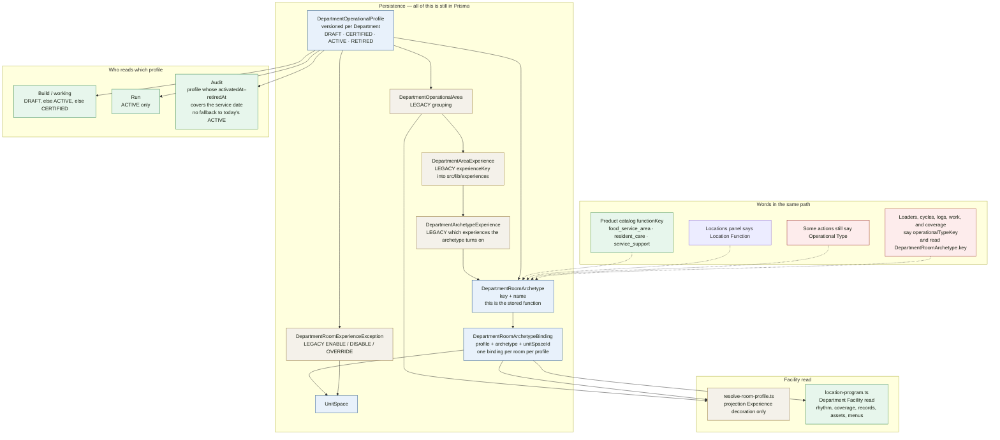
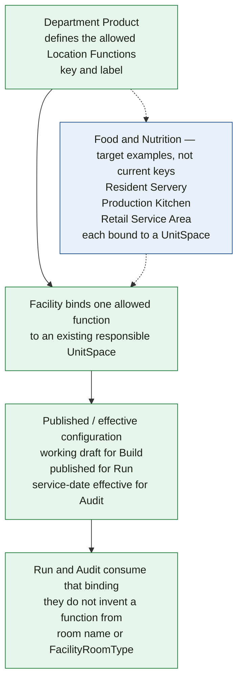

# Visual 4 — Current vs proposed Location Function model

November 2, 2026: the right-hand concept is retired. [08 — Location Function elimination audit](./08_LOCATION_FUNCTION_ELIMINATION_AUDIT.md) is the decision. The diagram below remains as the November 1 idea and the code that still implements it. Do not build toward it.

Left side is the repository. Right side was the November 1 concept. That concept is not a new table, and it is not the target.

## Current chain



“Operational Type” is not a separate stored object. It is the user-facing and code-facing name for `DepartmentRoomArchetype`. The Locations header has already moved to “Location Function.” Coverage copy, cycle validation messages, work applicability, and log target enums still say Operational Type.

Plant can select a profile archetype as a policy default inside `resolve-room-profile.ts` without writing a room binding. Direct bindings win. That policy path is part of the Experience-era resolver.

## Proposed conceptual model

This is the product concept. It does not mean “create `LocationFunction` now.”



```text
Department Product
    ↓
defines allowed Location Functions
    ↓
Facility binds a Location Function
to an existing responsible room
    ↓
Published / effective configuration
    ↓
Run / Audit consumers
```

Example from the decision, drawn as concept:

```text
Food & Nutrition
    ↓
Resident Servery
Production Kitchen
Retail Service Area
    ↓
UnitSpace binding
```

**Repo vs November 1.** The concept wants a Product list of functions. The current list for Food & Nutrition is a single key, `food_service_area`. The three names above are examples in the architecture decision. They are not implemented keys. Adopting a function today copies the catalog key onto the draft archetype; a free-typed label does not mint a new key.

## Product concept vs current persistence

```text
PRODUCT CONCEPT                         CURRENT PERSISTENCE
Location Function                       DepartmentRoomArchetype.key
                                        + DepartmentRoomArchetype.name
                                        on DepartmentOperationalProfile

Bind to a responsible room              DepartmentRoomArchetypeBinding
                                        unique per profile + unitSpace

Working vs published vs historical      profile status and activatedAt / retiredAt
                                        keep this while consumers need it

Not part of the concept                 DepartmentOperationalArea
                                        DepartmentAreaExperience
                                        DepartmentArchetypeExperience
                                        DepartmentRoomExperienceException
                                        Experience catalog
                                        the phrase Operational Type
                                        the phrase archetype, as product language
```

The decision’s rule for the later code pass: trace every profile, archetype, binding, and exception reader before simplifying. Do not add a third implementation beside this one in order to make the diagram look like the concept.
