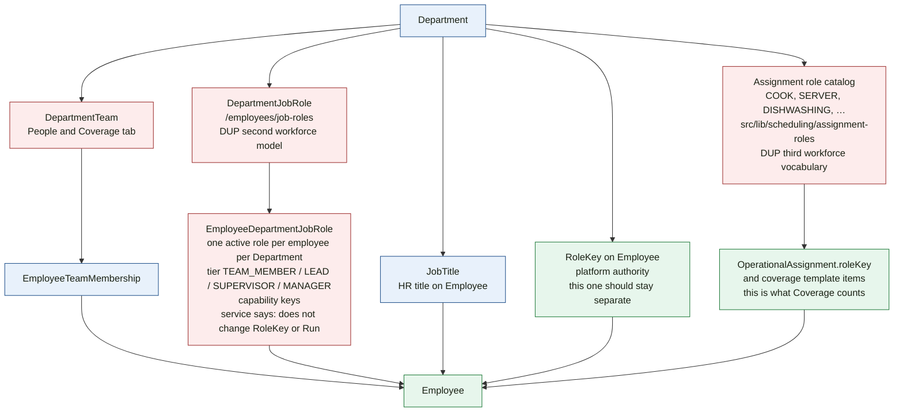
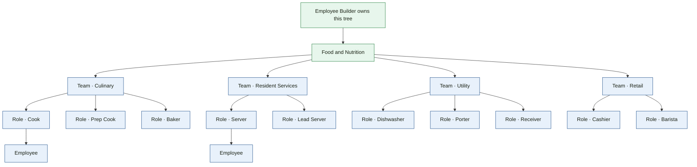
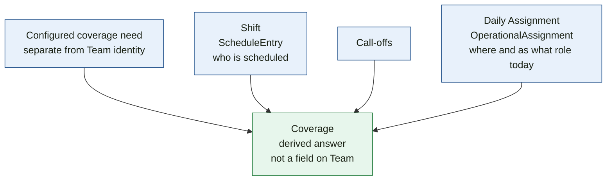

# Visual 5 — People / Team / Role / Coverage

Phase 5A leaves Team as an organizational grouping. Role is still not nested under Team. That consolidation is the later Employee Builder pass.

## Team after Phase 5A

```text
Department
  → Team
      name
      description
      managerEmployeeId    this person leads the Team
                           does not grant platform authority
      EmployeeTeamMembership
```

A Team does not own a room, a Location Function, a cycle, a coverage count, or a viewer's authorization. Department responsibility is the footprint. Coverage is the staffing need. `OperationalAssignment` is today's placement. Authorization stays on policy and role.

The earlier room membership, operational-type keys, and team-cycle tables are dropped. Location Program does not label a room with a Team.

## Current: Role is not one thing, and it is not under Team

Nothing in the schema places `DepartmentJobRole` under `DepartmentTeam`. An employee’s job role is one row per Department (`EmployeeDepartmentJobRole`). Team membership is a different row.



Starters for Department Job Roles are the generic tiers Team Member, Lead, Supervisor, and Manager. They are not Cook, Server, or Baker. Cook and Server are assignment roles. Both lists exist. Coverage’s own comment says the “what” of a requirement is `OperationalAssignment` `roleKey`, and that actual coverage is never Schedule, Team, or Job Role.

A further manager fact exists beside team manager and the MANAGER job-role tier: `DepartmentStaffManager`, plus the Department head. `EmployeeDepartment.roleType` is another `RoleKey` column, and the schema marks it dormant. The drawings do not merge those.

## Current: one configured need, then a derived answer

```text
TEAM CYCLE — retired in Phase 5A
    DepartmentTeamCycle is dropped
    a Team does not run a cycle
    a Team does not store requiredCount or coverage grain

COVERAGE NEED — the one configuration
    OperationalAssignmentTemplate + OperationalAssignmentTemplateItem
    Department on the template
    roleKey from the operational assignment catalog
    spaceId for a room; unitId only for a non-room Unit question
    period cycle stable keys
    requiredCount
    draft / published / effective dates
    Location Function keys are ignored
    Team requiredCount is not written and is not evaluated

ACTUAL
    OperationalAssignment for the service date
    same roleKey, location cover, and cycle-window overlap
    ScheduleEntry and Team membership do not fill a slot
    a call-down on the assignment keeps the fill and marks the slot at risk

ANSWER
    derived Coverage state
    grain: department + service date + canonical location + role + period
    there is no CoverageEpisode table
    the derived state is not stored as the requirement
```

**Phase 4.** Need B is the surviving configuration. Need A is an organizational cycle link with no staffing count.

## Proposed: organization in Employee Builder

The tree below is the November 1 ownership. The names are the decision’s Food & Nutrition example, not a seeded catalog.



```text
Employee Builder

Department
    ↓
Team
    ↓
Role
    ↓
Employee

Food & Nutrition
├── Culinary
│   ├── Cook
│   ├── Prep Cook
│   └── Baker
├── Resident Services
│   ├── Server
│   └── Lead Server
├── Utility
│   ├── Dishwasher
│   ├── Porter
│   └── Receiver
└── Retail
    ├── Cashier
    └── Barista
```

In that target:

- Team identity does not own physical rooms.
- Team identity is not Coverage.
- Role is the workforce role under the Team.
- `RoleKey` stays governance. It is not a job Role.
- Department Builder → People & Coverage reads this tree and shows coverage. It does not become a second authoring home.

**Repo vs November 1.** Getting to that tree means choosing which current role list is “Role.” Job Roles, assignment roles, and job titles are three lists today, and assignment roles are the ones Coverage uses.

## Proposed: Coverage is derived



```text
configured coverage need
        +
Shift
        +
Call-offs
        +
Daily Assignment
        ↓
Coverage
```

Department Builder may show the result on a Facility card. Editing the need stays with coverage configuration. Editing the person stays with Employee Builder. Editing today’s placement stays with Assignment.
