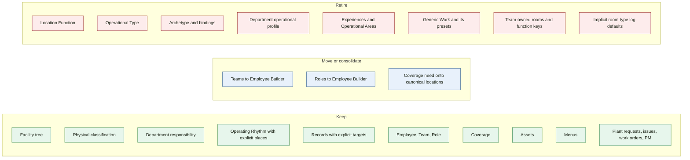

# What we are actually removing

November 2, 2026 supersedes the November 1 keep-list for Location Function. The dependency trace is [08 — Location Function elimination audit](./08_LOCATION_FUNCTION_ELIMINATION_AUDIT.md). Nothing in production code has been deleted.

## Keep

Facility physical tree, Facility Room Type, and Department responsibility. Operating Rhythm, with participation stored as location ids or department-wide. The Records engine, aimed at a facility, department, unit, space, or asset. Employee, Team, and Role as workforce concepts. Coverage as a derived answer. Assets. Menus. Plant requests, issues, work orders, and preventive maintenance.

Effective dating stays on the owner that has a real history question: the cycle, the record attachment, the coverage template, the menu. It does not stay on a Department room-classification profile.

## Move / consolidate

Teams and Roles move to Employee Builder. Coverage need becomes configuration that names canonical locations, a role, a count, and a cycle when the need is cycle-bound. It does not name a Location Function.

## Retire

Location Function, Operational Type, `DepartmentRoomArchetype`, its bindings, and `DepartmentOperationalProfile` when nothing else needs the profile. Operational Areas, the Experience catalog, area experiences, archetype experiences, and room exceptions. Generic Work, Work Plans, Expected Work, Work occurrences, and Work presets. Team-owned room programming, including operational-type keys on teams. Implicit Facility-type log defaults.

## Dependency proof required

Only the consumers that still expand a key at read time. Dropping the tables before they stop will mis-resolve cycles, records, audit, coverage, team scope, and experience projection. The audit names those files. Code volume is not itself a hold.
