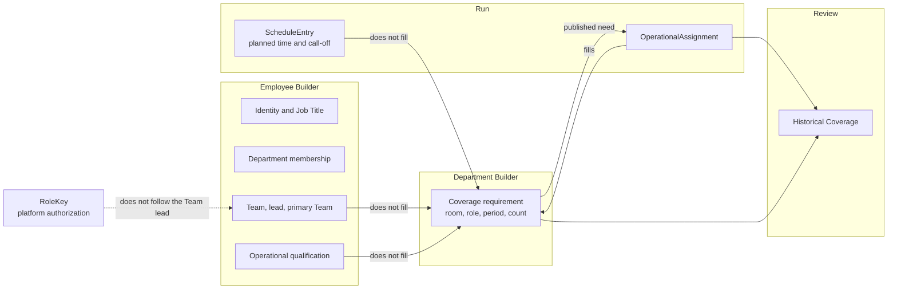
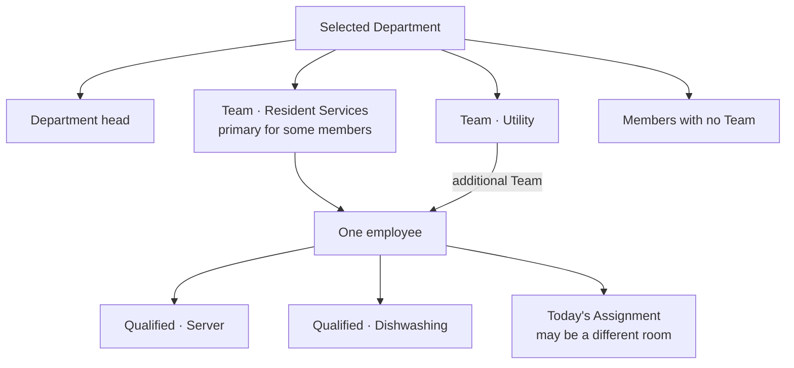

# Visual 2 — Data ownership

**Current architecture.** Each box is a fact that already has an owner. People & Coverage should read the first three and write only Coverage configuration.

Department → Team → Role → Employee is a way to read the workforce. It is not a database tree. A qualification is not a child of a Team. A Team lead is not a RoleKey.

The second drawing is the composition the screen does not assemble today. The Team editor on People & Coverage currently writes the Team and the lead. Membership and qualifications are written in Employee Builder.
