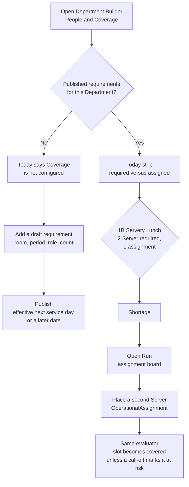

# Visual 4 — Manager workflow

**Proposed path.** The shortage is discovered on People & Coverage. The placement is made in Run. The requirement, when it is wrong, is edited in the Coverage draft on this same page.

Two people on the schedule do not clear the shortage. The second person has to have an `OperationalAssignment` whose role, room, and period match the requirement.

If the manager meant one Server, they change the draft requirement and publish. That does not rewrite today's assignments by itself. The published need applies on its effective date.
