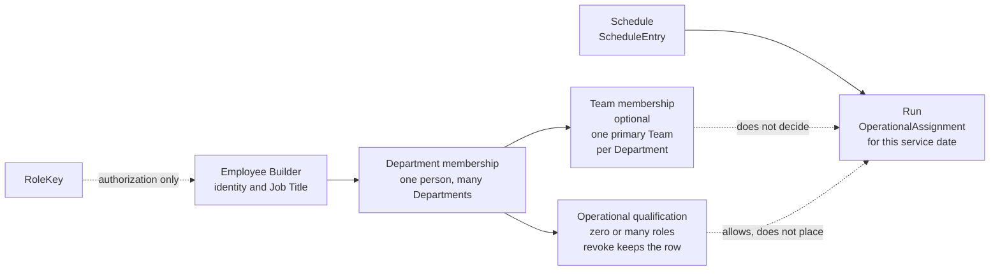

# Visual 5 — Employee workflow

**Current ownership.** These are separate facts. Walking down the page is not a database hierarchy.

| Situation | What stays put | What changes |
|---|---|---|
| No Team | Department membership | Organization shows them under No Team |
| Server and Dishwashing | One Team, or none | Two qualifications, not two Teams |
| Covers Utility today, primary Team is Resident Services | Team membership | Today's assignment |
| Also in Environmental Services | Each Department has its own membership, Teams, and qualifications | The other Department's page |
| Team lead | `managerEmployeeId` | RoleKey is unchanged |
| Qualification revoked | The row, status `REVOKED` | They are not shown as qualified |

Employee Builder is where a manager changes membership, Team, lead, and qualifications. People & Coverage links there. It does not save those facts.
