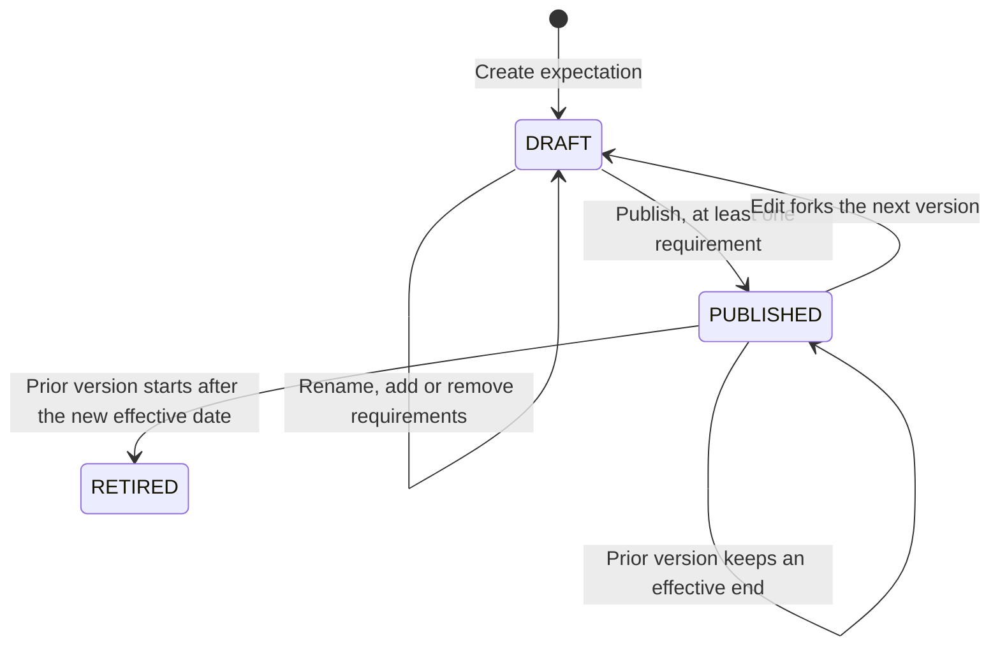

# Visual 6 — Coverage lifecycle

**Implemented lifecycle.** This is what `publishCoverageExpectation` and `ensureWorkingCoverageDraft` do. It is not a new workflow.

Details that are already true:

- A new row is version 1, `stableKey` prefixed `cov_`, status `DRAFT`, no effective dates.
- A draft is edited in place. A published row is not mutated. The next version copies its items.
- Publish rejects an empty draft.
- A blank, today, or earlier effective date becomes the next facility service day. A future date is kept.
- The previous published version of that `stableKey` receives `effectiveTo` the day before. If that previous version had not started yet, its status becomes `RETIRED`.
- Run reads `PUBLISHED`, active, and effective on the service date. Drafts do not apply.
- Review can read `PUBLISHED` or `RETIRED` rows whose interval contains the date.
- The People & Coverage screen has no retire button and no history list. `RETIRED` exists because publish writes it.

A requirement item stores `spaceId`, `roleKey`, `applicableOperationalCycleStableKeys`, and `requiredCount` of at least 1. Empty cycle keys are rejected on this write path. A legacy row with empty keys still means every period when read.

The staffing Assignment Templates screen writes these same tables and can Apply an active row that was never published. That path is outside this lifecycle. The audit recommends removing it as an editor.
