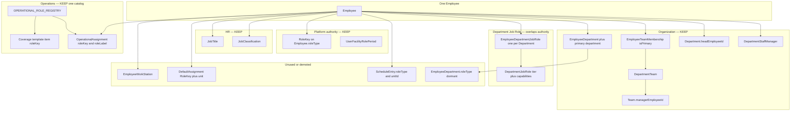

# Visual 1 — Current workforce architecture

**Label:** current. November 4, 2026.

Overlapping stores are the boxes that all claim to say what a person "is."

`DepartmentJobRole` uses the words Lead, Supervisor, and Manager, and stores capability strings that look like permissions. Run and the policy engine do not read them. `WorkStation` names Cook and Server again. The assignment form ignores both and uses the registry.
