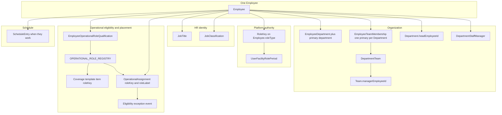

# Visual 1 — Workforce architecture

**Label:** current after Phase 7B. November 4, 2026.

Department Job Role, Default Assignment, EmployeeWorkStation, `EmployeeDepartment.roleType`, and `ScheduleEntry.roleType` / `unitId` are removed. A qualification does not grant RoleKey. A Team lead does not grant RoleKey. An exception does not create a qualification.
