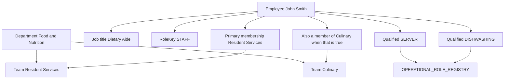

# Visual 2 — Proposed organizational architecture

**Label:** proposed. Not an approved schema.

The screen can look like Department → Team → people, with roles beside the people. The database should not make the operational role a child of the team.

Many-to-many that must stay:

- One employee, many Departments.
- One employee, many teams in a Department, one primary.
- One employee, many registry roles in a Department.
- One team, many employees.
- One registry role, many employees, and no required team.

Do not add a Role row that exists only under Culinary. `COOK` exists because the platform catalog says so. People on Culinary may be qualified for it.
