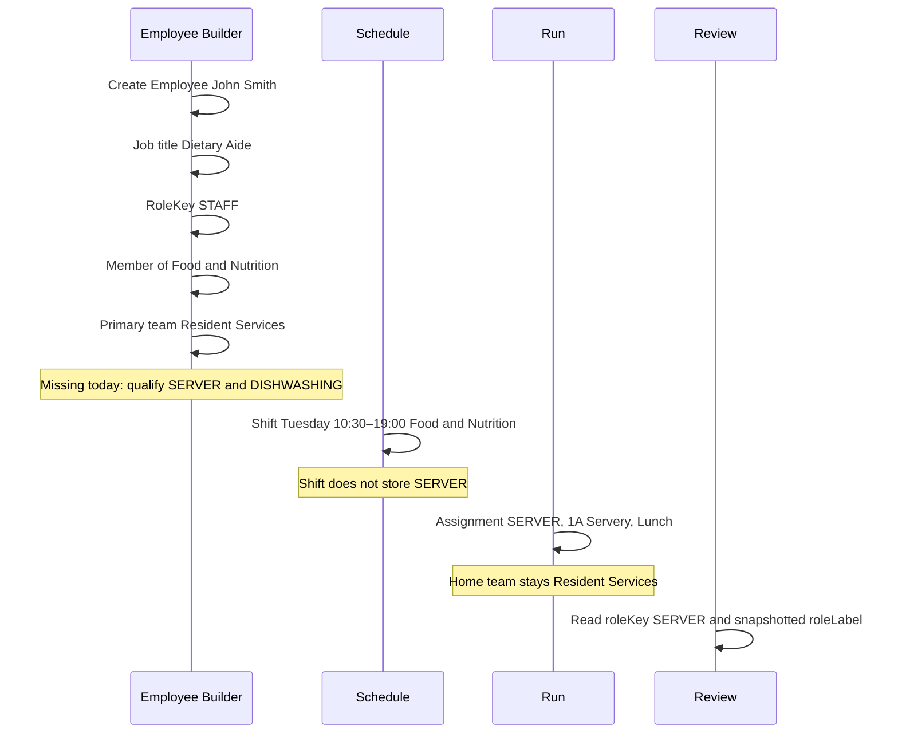

# Visual 3 — Identity, eligibility, and today's assignment

**Label:** proposed path for one person. Qualification is the step the code does not have yet.

| Fact | John's value | Store today | Changes when he covers dishroom today? |
|---|---|---|---|
| HR title | Dietary Aide | `JobTitle` | No |
| Platform authority | STAFF | `RoleKey` | No |
| Home team | Resident Services | `EmployeeTeamMembership.isPrimary` | No |
| Qualified roles | SERVER, DISHWASHING | Not stored | No |
| Shift | Tuesday afternoon | `ScheduleEntry` | No |
| Today | SERVER at 1A, Lunch | `OperationalAssignment` | The assignment is the change |
