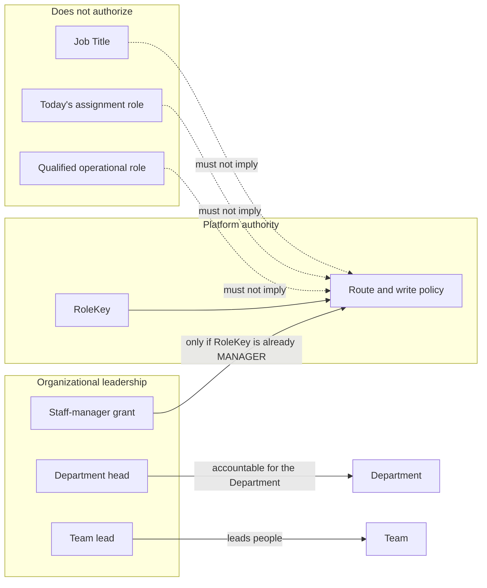

# Visual 4 — Management and authorization

**Label:** current facts, with the proposed rule that they stay separate.

A team lead does not become `RoleKey.MANAGER`. A Department head does not become `FACILITY_ADMINISTRATOR`. Qualifying someone for `SERVER` does not add a management route. The staff-manager grant is the only intentional delegation, and it requires the platform role first.
