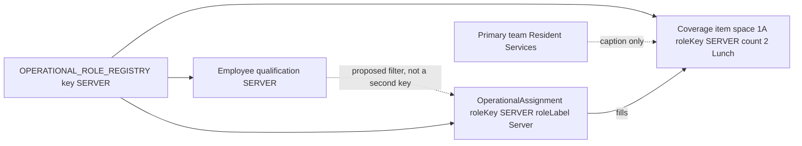

# Visual 5 — Coverage and assignment

**Label:** current, and the proposed qualification link. Coverage already uses the registry. Qualification does not exist yet.

The coverage row does not store a team id or an employee id. The assignment stores the person, the place, the key, and the label. Review reads the assignment snapshot. Renaming the registry label later does not rewrite that snapshot.

Team is not how Coverage finds the room. Facility responsibility and the explicit `spaceId` do that.
