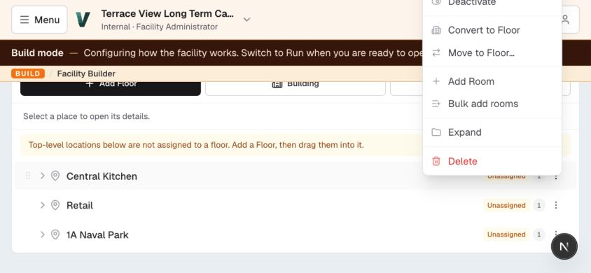
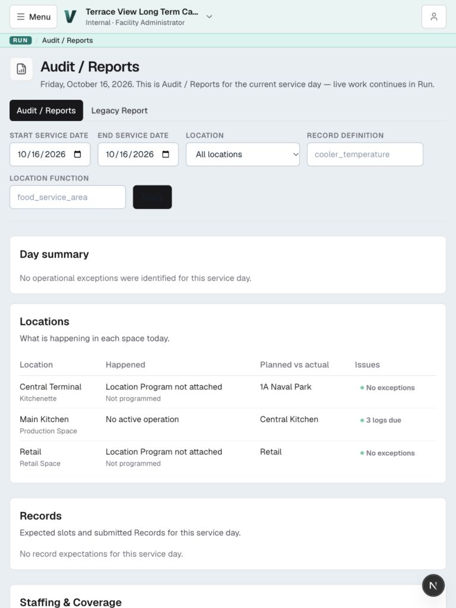
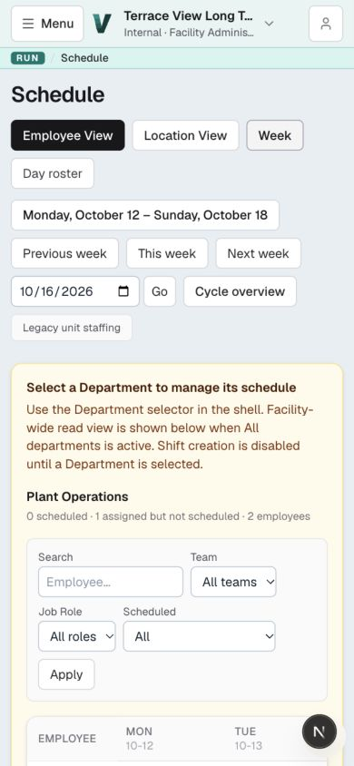
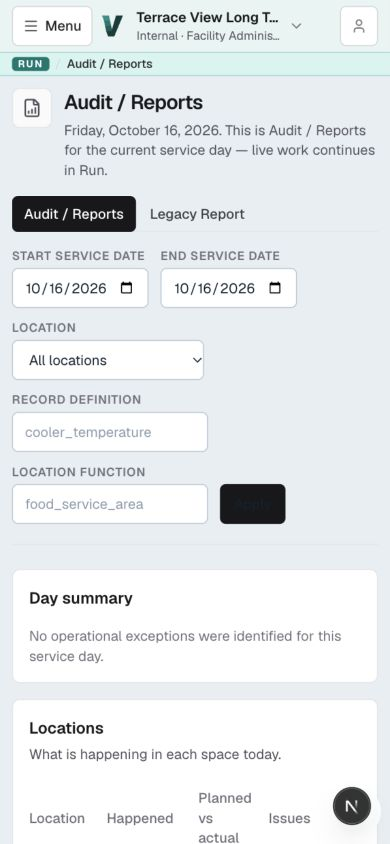
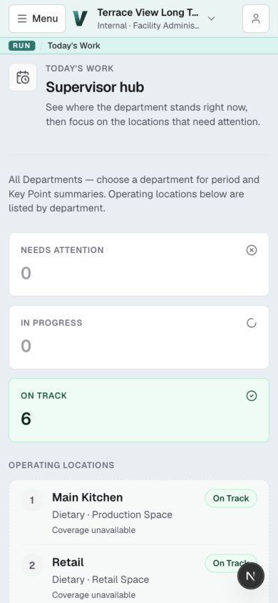
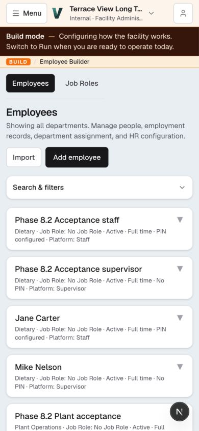

# Responsive UI review and correction plan

Reviewed October 16, 2026 against the running local app at `http://127.0.0.1:3000`.

## Recommendation

Keep the current visual identity and improve how each screen uses its available space. Correct the clipped menus and unreadable controls first. Then standardize headers, touch controls, and filters before adapting the schedule, reports, and builders individually.

The app already has responsive foundations: desktop navigation becomes a drawer, the workspace chooser becomes a tablet sheet or a full-screen compact view, and the location workspace brings due work ahead of coverage on narrow screens. These are useful patterns to extend.

The largest problem is inconsistent adaptation. Some screens reflow thoughtfully; others wrap desktop controls into several rows, stack large summary cards, or retain enough introductory content to bury the actual work. The height of the complete header area matters as much as the heading's font size.

## What was inspected

Browser viewport sizes:

- Desktop: **1440 × 900**.
- Landscape tablet / small laptop: **1024 × 768**.
- Portrait tablet: **768 × 1024**.
- Narrow screen: **390 × 844**.
- Short landscape screen: **844 × 390**, specifically for menu placement.

Not every route was inspected at every size. The desktop dashboard and schedule were compared with compact views; tablet and compact checks covered the main operational and builder layouts. Screens included Business Workspace, Today's Work, a Main Kitchen location workspace, Schedule, Audit / Reports, Build Home, Department Builder, Facility Builder, Employee Builder, Menus, Maintenance, and legacy Logs. Desktop sign-in was also viewed.

Interactions included opening navigation, workspace selection, the account menu, a scheduling select, Facility Builder action menus, and the Add Employee drawer. Forms were inspected without submission. The department lens was temporarily changed to Dietary and returned to All departments.

This is a visual review using the existing local data and a Facility Administrator account. It is not a certification of every role, record form, or route. There were no menus or operational assets available to inspect in populated editor/detail views. Physical tablet touch behavior, the software keyboard, Safari, and staff PIN sessions need a later verification pass. Native select expansion was visible in accessibility state, but its operating-system popup was not captured in screenshots.

## Findings and proposed corrections

### 1. Priority 1 — Facility Builder menus can open outside the screen

At **844 × 390**, scroll the Facility Builder tree to its lower position and open **More actions for Central Kitchen**. “Rename” is completely above the viewport; “Deactivate” is partly above it. In the saved reproduction, Rename spans approximately **−46 to −14 pixels** vertically. Menu rows are **32 pixels** high.

The positioning code flips the menu above the trigger when the bottom would overflow, but does not clamp the resulting position to the top edge. It also lacks a viewport-constrained scrolling surface.

**Correction:** constrain the menu to all four viewport edges, with a small margin; measure the actual panel; cap its height and allow internal scrolling when necessary. Reposition on viewport changes and scrolling, or dismiss when the anchor is no longer visible. Give touch menu rows at least 44 pixels of usable height. Verify Escape, focus, and returning focus to the trigger. For long action lists on compact touch screens, a labeled action sheet is preferable to a small floating menu.

Implementation: `src/app/(protected)/admin/facility/builder/facility-builder-client.tsx`, `ContextMenuOverlay` and `ContextMenuItem`. Reuse a shared overlay behavior rather than maintaining another independent positioning recipe.

### 2. Priority 1 — Reports has an almost unreadable Apply button

The Reports Apply button uses a dark background while its computed text color is **rgb(18, 32, 44)**. This was visible at tablet and compact sizes.

The button combines `app-button` with `text-white`. The unlayered `.app-button` rule in `globals.css` sets its own foreground color, overriding the intended Tailwind utility.

**Correction:** use the existing design-system `Button` with its primary variant in this form. Audit other dark buttons using the same legacy class combination. Resolve the CSS layering intentionally for remaining legacy consumers; a global change needs visual checks because it affects other screens. Validate contrast from computed styles as well as screenshots.

Implementation: `src/app/(protected)/reports/review-date-form.tsx`, `src/app/globals.css`, and `src/components/design-system/Button.tsx`.

### 3. Priority 2 — Header stacks take too much of a smaller screen

The shared `PageHeader` already uses a reasonable 20-pixel compact title and 24-pixel larger-screen title. Other pages use their own title markup; Schedule still uses 24 pixels at 390 pixels wide. Workspace section headings are also 20 pixels, giving them nearly the same prominence as the page title on compact screens.

On Build screens, the global header, explanatory Build banner, mode indicator, context summary, and local tabs accumulate before the editable content. On the dashboard, the greeting, operation status, full-width customization panel, and generous section spacing have a similar effect.

**Correction:** establish one responsive header recipe across Run, Build, and Admin. Use approximately 20–24 pixels for page titles and 16–18 pixels for ordinary section titles. Reduce redundant explanations and spacing on compact screens; keep the visible mode label and required context. Move optional help behind an explicit Help/Details control. Put the primary action on its own clear row when it cannot comfortably fit beside the title.

Implementation: `page-header.tsx`, `SectionHeader.tsx`, `build/build-breadcrumb.tsx`, `product-mode-banner.tsx`, and the design tokens. Begin with the shared components, then replace the inconsistent page-specific markup.

### 4. Priority 2 — Schedule retains a desktop control arrangement

At **390 × 844**, with All departments selected, the week grid started around **790 pixels** down the screen. Its table measured approximately **941 pixels** inside a **330-pixel** scrolling panel. Search and select controls measured **34 pixels** high. At landscape-tablet width, the same controls were considerably easier to scan.

**Correction:** create a deliberate compact toolbar: date navigation, current view, and one Filters control. Put less frequent filters in an expandable panel with an applied-filter count. Make all controls touch-friendly. Present an easy day-roster entry on narrow screens, preserving explicit Week/Day selection in the URL and keeping the week view available. The week view should retain its sticky employee column and have an obvious horizontal-scroll affordance. Avoid changing the meaning or contents of a schedule when changing its presentation.

Implementation: `src/app/(protected)/staffing/page.tsx` and `src/components/scheduling/week-employee-schedule-grid.tsx`.

### 5. Priority 2 — Filters wrap unevenly and do not use the available width

Reports leaves its Location and definition fields at intrinsic/minimum widths. On compact screens, that creates a tall series of short controls and unused space to the right. Employees and Schedule use different filter sizing and spacing again. Several controls are below the app's existing 40-pixel minimum.

**Correction:** consolidate on the existing `Field`, `TextInput`, and `Select` primitives. Use intentional grids: one column on narrow screens, two where labels and values comfortably fit, and more only when the content allows. Let fields fill their grid cell. On compact operational pages, make search and date available immediately and move secondary filters into an expandable section. Show active filters outside the collapsed panel so users understand what they are seeing.

Use at least 44-pixel interactive height for touch layouts. For editable touch inputs, use 16-pixel text as the starting point and validate on an actual tablet/phone; retain readable 14–16-pixel body text instead of shrinking everything.

Implementation: `src/components/design-system/Field.tsx`, the Reports filter form, employee filters, scheduling filters, and legacy forms as touched by this work.

### 6. Priority 2 — Dashboard and daily-work summaries bury the list

At compact width, the dashboard repeats “No locations currently need attention” in its overview and empty-state panel. “Customize Workspace” occupies a full-width panel before the operational sections. On Today's Work, three summary tiles stack vertically and the operating-location list begins roughly **670 pixels** down the screen.

**Correction:** make the top area a compact title/context row and a concise operational summary. Keep meaningful exceptions prominent. Present quiet counts in a compact summary strip or two-column arrangement with adequate label space; do not squeeze three long labels into tiny tiles. Put workspace customization in a smaller secondary control. Keep saved customization preferences and underlying operational status unchanged.

Implementation: `business-workspace/business-workspace-view.tsx`, `business-workspace/workspace-customize.tsx`, `design-system/MetricCard.tsx`, and the Today's Work summary layout.

### 7. Priority 2 — Report tables need a narrow-screen reading pattern

The compact Reports table fits inside its panel, but its column headings and values wrap heavily. Fitting the table's width does not make its relationships easy to read.

**Correction:** use labeled location summaries on narrow screens, preserving each column's meaning. Keep comparison tables at tablet/desktop widths and for inherently tabular datasets; contain horizontal scrolling within the table when needed. Do not hide issues, status, or actionable information simply to achieve a fit.

Implementation: `src/app/(protected)/reports/review-layout.tsx` and the canonical review views.

### 8. Priority 2 — Some navigation is harder to discover on compact screens

The shell truncates the long facility name and role. Local tab strips can hide destinations such as Vendors or later Department Builder tabs off the right edge. While switching from Run to Build inside the compact menu, the new page loaded with the menu still covering it.

**Correction:** keep the workspace name as readable as possible and show its full identity in the chooser. Offer a clear overflow affordance for local tabs, keep the selected tab visible, and use a labeled section chooser where a long tab strip no longer works comfortably. Close the compact drawer after a mode change as it already does for destination changes.

The mode-change issue has a specific integration cause: `ShellModeNav` supports `onNavigate`, but the node passed from `AppShell` into `ResponsiveShellNav` does not receive that drawer's close callback.

Implementation: `shell/current-workspace-region.tsx`, `shell/workspace-shell-header.tsx`, `design-system/SubNav.tsx`, `responsive-shell-nav.tsx`, and `shell/shell-mode-nav.tsx`.

### 9. Priority 2 — Builder support information competes with the configuration

Department Builder's Overview places a lengthy Record engine panel immediately below the tabs. At compact width it fills the remainder of the initial screen, leaving the department configuration below it. Employee Builder similarly opens with an expanded filter panel; its first employee starts around 610 pixels down the compact screen.

**Correction:** use progressive disclosure for advanced engine configuration and background explanations. Keep current engine/status visible and preserve all required notices when editing. Use a compact search row plus expandable advanced employee filters. In the Facility Builder, preserve visible touch actions and give selected-place details an explicit focused view or drawer, with an obvious way back to the tree.

Implementation: the Department Builder overview and its Record engine panel, employee filter layout, and Facility Builder tree/detail layout.

## Proposed screen behavior

### Desktop, starting at 1280 pixels

- Retain the current persistent rail unless visual verification shows a specific reason to change its threshold.
- Show table comparisons and multi-column work areas when their content fits.
- Keep toolbars compact and aligned; use the existing maximum-width system for large monitors.
- Use anchored dropdowns that stay inside the viewport, including on shorter windows.

### Tablet, 768–1279 pixels

- Retain the navigation drawer and tablet workspace chooser.
- Use two-column forms where there is enough room for labels and values.
- Keep touch actions visible; avoid interactions that require hover.
- Prefer a focused editor with an explicit selection/detail transition when two panes are too cramped.
- Size overlays according to both width and available height, especially in landscape.

### Compact, below 768 pixels

- Use a concise header and early primary content.
- Prefer single-column forms and full-width fields.
- Keep search/date visible; disclose secondary filters deliberately.
- Use full-screen or sheet presentations for long selectors and dense action lists.
- Use readable record summaries or a day roster where a wide comparison table cannot be scanned comfortably; retain access to full tables.

These are proposed presentation rules, not a requirement to force every screen to switch at exactly the same width. Component fit and input method should also guide the final implementation. No page should be scaled down with CSS zoom or a transform.

## Implementation order

1. **Fix visibility defects.** Correct Facility Builder menu placement and Reports button contrast. Close the compact menu after mode navigation. Verify each with the saved reproduction.
2. **Standardize shared components.** Set responsive header spacing, title hierarchy, input/button sizing, and constrained overlays. Migrate the affected controls onto the existing primitives rather than creating a competing design system.
3. **Adapt the frequent operational screens.** Dashboard and Today's Work first, then Schedule and Reports. Give each a clear initial viewport, coherent filters, and a readable compact data presentation.
4. **Adapt builders and forms.** Employee Builder, Department Builder, Facility Builder, and then populated Menu/Asset/Record editors. Review the compatibility Logs screens without changing their record engine or route responsibilities.
5. **Verify and document before/after results.** Add meaningful browser checks for menu containment, control visibility, navigation closure, and critical interactions; take matching screenshots with the same data and viewport sizes. Run the repository's appropriate static checks after application changes.

Keep these as small reviewable changes. The menu/contrast corrections can be delivered independently of the denser page redesigns.

## Completion criteria

- No primary action, dropdown option, or dialog control is clipped at the tested sizes.
- Menus remain reachable near every edge and at 390-pixel viewport height; long menus scroll internally.
- Primary text and action labels remain legible, including the Reports Apply button.
- Touch controls have at least 44 pixels of usable height in touch layouts.
- Search, date, selected scope, and active filters are clear without opening every panel.
- Operational screens expose a useful status, work item, or primary action in the initial viewport; configuration screens bring the configured object into view early.
- Horizontal scrolling belongs to an intentional table/tab surface, with a discoverable affordance.
- Navigation and overlays work with keyboard, Escape, focus return, and touch.
- Explicit filters, date/view selections, form values, and saved dashboard preferences survive presentation changes.
- Test the 767/768 and 1279/1280 transitions, short landscape windows, 200% browser zoom, and long names/large lists in addition to the baseline viewports.
- Complete a physical-tablet pass for touch, software keyboard, orientation changes, and save/cancel behavior.

## Additional baseline screenshots

- [Dashboard — desktop, 1440 × 900](workspace-desktop.jpg)
- [Dashboard — portrait tablet, 768 × 1024](workspace-tablet.jpg)
- [Dashboard — compact, 390 × 844](workspace-compact.jpg)
- [Schedule — desktop, 1440 × 900](schedule-desktop.jpg)
- [Menu list — landscape tablet, 1024 × 768](menus-tablet.jpg)

Application code was not changed as part of the initial review. The approved corrections have since been implemented; see the [implementation notes, validation, and before/after screenshots](IMPLEMENTATION.md).
